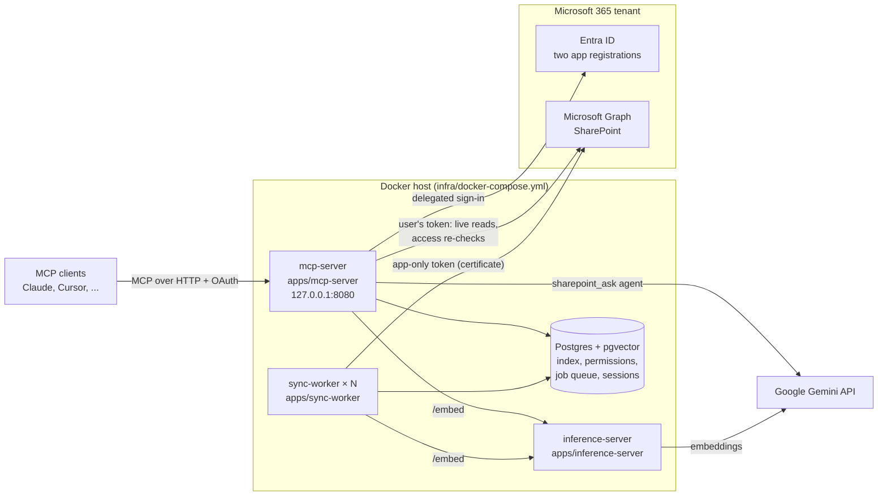

# sharepoint-knowledge-agent
SharePoint Q&A agent with a built-in MCP server. Entra ID delegated auth means users only get answers from content they already have access to.

## Docs
- [Architecture](docs/architecture.md): target design (mcp-server with an agent tool, sync-worker, inference-server, Postgres index, permission model) and what is built so far.
- [Setup](docs/setup.md): configure Entra ID, run the MCP server (Docker or local) and connect a client.
- [Microsoft tenant setup](docs/microsoft-tenant-setup.md): step-by-step walkthrough from a new Azure/Microsoft 365 tenant and Entra app registration to a validated working server.
- [MCP OAuth sign-in](docs/oauth.md): how the sign-in flow works, and its limits.

## Infrastructure

Shared code lives in `packages/sharepoint/` (Entra sign-in + Graph client) and `packages/rag/` (schema, job queue, extraction, search). Evals are in `evals/`, shared test fixtures in `tests/`. Postgres is only on the `backend` compose network and is published to the host on loopback only; see [Architecture](docs/architecture.md) for the full design.

One shared `.venv` at the repo root; each package is installed editable by `requirements.txt`. Config comes from the root `.env` (shared), `.env.mcp` (the mcp-server's Entra app) and `.env.worker` (the sync-worker's separate Entra app).

Tests: `.venv/bin/python -m pytest`. Database tests need a Postgres with pgvector in `TEST_DATABASE_URL` (see `tests/fixtures.py`) and are skipped without it.

## Security notes
- Users only get content they can open in SharePoint: search filters by their Entra id and groups inside the query, then re-checks every result live with their own token. Failures return nothing.
- The mcp-server is plain HTTP on `127.0.0.1` only, for use from the same machine. Serving other users needs HTTPS in front of it, which isn't set up ([Setup](docs/setup.md#team-use-not-set-up)).
- Clients register dynamically, but only to loopback or operator-allowed redirect URIs.
- Tokens issued by this server are opaque, stored hashed, bound to the user's Entra account, and expire after 1 hour (refresh tokens: 30 days, rotated). Entra tokens are stored encrypted with `TOKEN_ENCRYPTION_KEY`; keep that key out of the database.
- The sync-worker has its own Entra app with app-only read access; signed with a certificate the mcp-server never holds.
- The index holds everything the crawler can read: keep Postgres on a private network and its disk encrypted. Embeddings and `sharepoint_ask` both send text to Google's Gemini API by default (chunk text for embeddings, text the user may read for the agent). `ASK_MODEL=none` turns the agent off, or points it at another provider.
