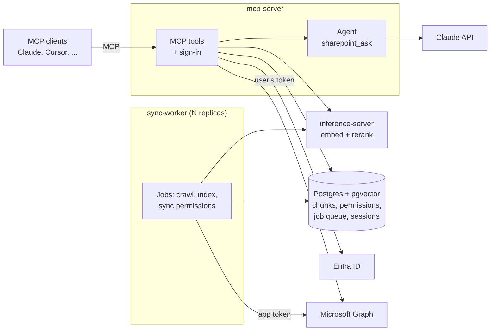
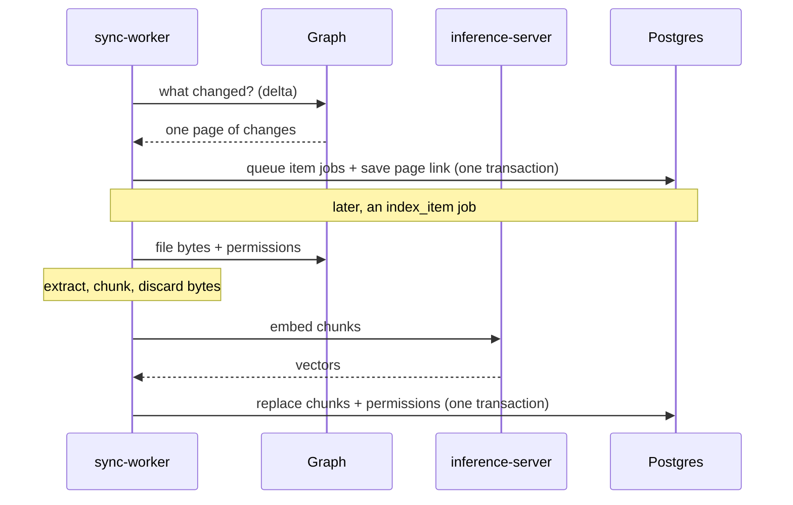
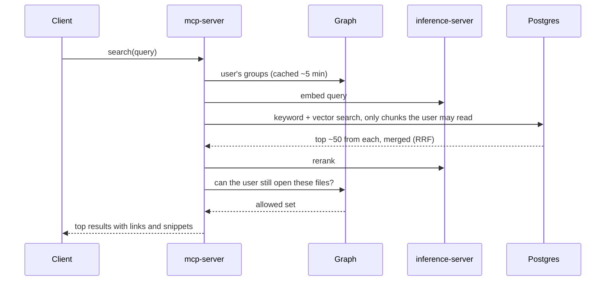
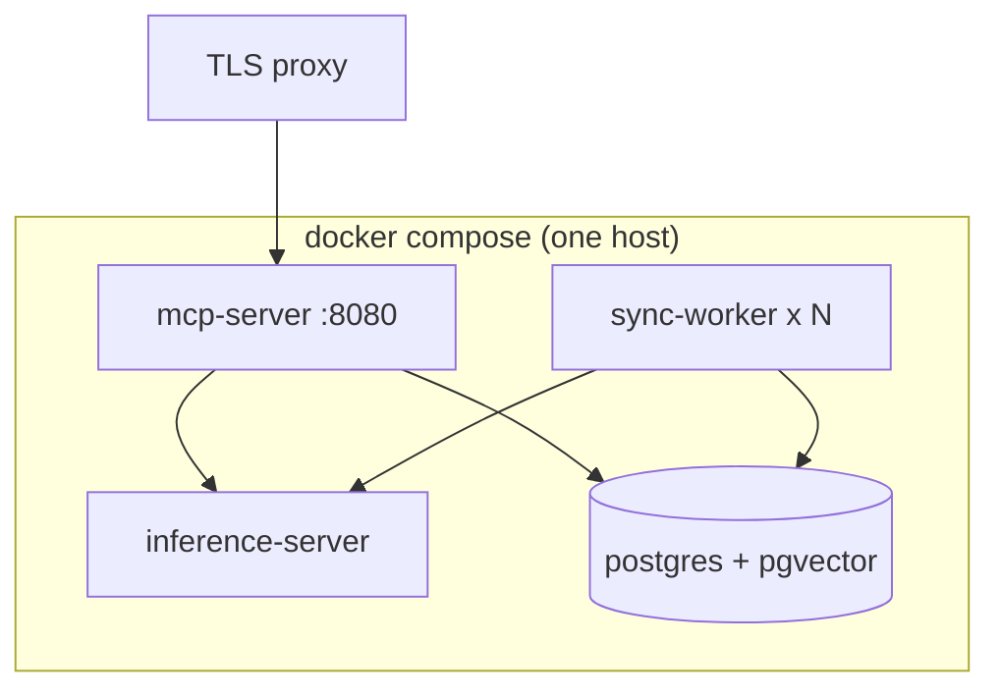

# Architecture

A search and Q&A service over SharePoint, exposed as an MCP server. Users only get content they can already open in SharePoint. It has retrieval tools and an agent tool that researches a question and returns an answer with sources.

## Goals

- **Never leak.** Results only include files the asker can open. Everything else bends around this.
- **Stay fresh.** New content shows up in minutes. Revoked access is blocked right away by a live check; group and permission *grants* can take a few minutes.
- **Search well** across English and Spanish: keyword plus meaning-based search, then reranking.
- **Run from `docker compose up`** and scale by adding replicas.
- **Not now:** a web app, several tenants or sources, writing to SharePoint, keeping copies of the original files.

## Where we are

| Piece | State |
|---|---|
| MCP server with Entra sign-in. Its `sharepoint_search` calls Graph's live search. No Postgres. | Built (`apps/mcp-server/`) |
| Live access check for a batch of files (`verify_access`) | Built (`packages/sharepoint/`) |
| Text extraction, chunking, Gemini embeddings, Postgres schema, permission-filtered hybrid search | Built, but no tool uses it yet (`packages/rag/`) |
| Evals for extraction, permissions and retrieval quality | Built (`evals/`) |
| sync-worker, inference-server, `sharepoint_ask`, multi-user hardening | Not built |

The built search keyword side uses Postgres's `simple` text config: no stemming, so Spanish "contrato" won't match "contratos". The meaning-based side makes up for it today.

## Overview



| Component | Job | Scales by |
|---|---|---|
| **mcp-server** | Serves MCP tools, signs users in, runs searches and the agent. Target: no state of its own (it's all in Postgres). Today, sessions and accounts are in memory. | More replicas |
| **sync-worker** | Copies SharePoint into the index and keeps permissions current. | More replicas, up to Graph's rate limits |
| **inference-server** | Turns text into vectors and reranks results. | More replicas; a GPU if indexing is heavy |
| **Postgres** | Everything else: search index, permissions, sync state, job queue, sessions, audit log. | Bigger machine |

The mcp-server and sync-worker share the `sharepoint_rag` and `sharepoint_client` packages but run as separate containers.

## mcp-server

A Python MCP server (the `mcp` SDK served by uvicorn) at `/api/mcp`. It also acts as its own OAuth server and passes sign-in through to Entra ([details](oauth.md)). Clients get opaque tokens from us and never see Entra tokens. We store Entra refresh tokens server-side (encrypted, see [Security](#security)).

| Tool | State |
|---|---|
| `sharepoint_search` | Today: Graph live search. Planned: our index, returning cited chunks. |
| `sharepoint_ask` | Planned: the agent below. |
| `sharepoint_read_file`, `sharepoint_find_sites`, `sharepoint_list_drives`, `sharepoint_list_items` | Built. Always live Graph with the user's token, so they show everything the user can see, indexed or not. |
| `sharepoint_whoami`, `sharepoint_logout` | Built. |

### The agent: `sharepoint_ask`

For callers that want an answer, not raw results. The server runs its own loop on the Claude API: search, read a file, refine, search again, then answer with sources.

- **Tools it can use** (internal, read-only): `search`, `read_file`, `list_items`.
- **Permissions:** `search` goes through both [permission layers](#permissions). `read_file` and `list_items` call Graph with the user's token, so Graph itself refuses anything the user can't open. The agent can never get more than the user could by calling the tools directly.
- **Output:** answer text plus sources (title, link, quote). A source must be one the loop actually retrieved. "Not found" is a valid answer.
- **Limits:** max steps, tokens and time per call, and a per-user rate limit. It sends progress updates while working and returns what it found if it runs out of budget. Counters and token usage live in Postgres, so replicas share them.
- **Prompt injection:** documents are untrusted. A planted instruction could make the agent read other files the user can open and quote them in its answer. Mitigations: the answer is plain text, links are limited to cited sources, and the agent has no way to call out to any other URL. It still can't be made to read anything the user couldn't read.
- **Data sent out:** text the user may read goes to the Claude API. The tool is off unless `ANTHROPIC_API_KEY` is set.

## sync-worker

Keeps the index in step with SharePoint. It uses an **app token** (not a user's), so it can read everything regardless of who is signed in. It gets its **own Entra app registration and secret**, separate from the mcp-server's. Otherwise anyone who breaks into the mcp-server (the most exposed component, and the one that runs the prompt-injectable agent) could mint tenant-wide tokens. Today `get_app_token()` sits in the package shared with the mcp-server; it moves into the worker's own code, and the mcp-server image and `.env` don't get the worker's secret.

**Open question: which app permission?** `Sites.Selected` (per-site grant) is the safest, but Microsoft's docs for [listing a file's permissions](https://learn.microsoft.com/en-us/graph/api/driveitem-list-permissions?view=graph-rest-1.0) list `Files.Read.All` as the lowest option and don't mention `Sites.Selected`. It might work, perhaps only with a write-level grant. Test this first: grant a test site `Sites.Selected` at `read`, then `write`, and fetch an item's permissions. If it fails, we fall back to tenant-wide `Files.Read.All`/`Sites.Read.All`, which would also let the worker find sites on its own.

Work is split into small jobs on a Postgres queue (`FOR UPDATE SKIP LOCKED`). No Celery or Redis: one less service, and jobs commit together with the data they change.

| Job | When | What it does |
|---|---|---|
| `discover_sites` | Hourly | Reads the admin's site list (`Sites.Selected` can't list sites), finds each site's drives, starts a `crawl_drive` for new ones. |
| `crawl_drive` | Every few minutes | Asks Graph "what changed since last time" (delta). For each page of changes, queues the item jobs and saves the page link in one transaction, so a crash re-reads at most one page. Only the last page gives the final cursor for the next run. |
| `index_item` | Per changed file | Skips if the file's etag is unchanged and it's already indexed in every live generation. Otherwise reads permissions, downloads, extracts, chunks, embeds, and replaces the file's chunks and permissions in one transaction, under the same "only if newer" rule as `sync_item_acl`. |
| `delete_item`, `purge_drive` | On delete, or when a site is removed | Remove the file's (or drive's) data. |
| `sync_item_acl` | From the daily sweep | Re-reads one file's permissions. |
| `sweep_acls` | Daily | Queues `sync_item_acl` for every file. Needed because delta doesn't reliably report permission-only changes. |
| `backfill_generation` | New generation | Fills a new index [generation](#index-generations). |

Rules:
- **Newest permissions win.** Every job that writes permissions (`index_item`, `sync_item_acl`, `backfill_generation`) notes when it read them from Graph and writes only if that is newer than `sources.acl_synced_at`. Otherwise a slow `index_item` that read permissions before a revocation could write the old, too-open list back until the next sweep.
- **Rate limits.** Graph returns `429` with `Retry-After`. One shared limiter, `$batch` where possible.
- **Expired cursor (`410`).** Re-crawl the drive. Unchanged files are skipped by etag. A re-crawl can't report files deleted in the gap, so it stamps every file it sees with a `crawl_id`. Only when that full pass has reached the last page, one transaction deletes files of the drive without the new stamp. Normal delta runs return only changed files and never delete this way, and a failed or partial re-crawl deletes nothing. Old text must not linger.
- **Failures.** A bad file is marked `error`, retried with backoff, and shown to admins. It doesn't block the drive.
- **No file copies.** File bytes are read, processed and thrown away. `sharepoint_read_file` always goes live.
- **Webhooks (optional, later).** Graph change notifications could trigger an early crawl. Polling is enough to start.

## inference-server

A separate service for the embedding model and the reranker, so model weights and GPUs stay out of the other services. Two calls: `POST /embed` (texts → vectors) and `POST /rerank` (query + passages → scores).

It can use a hosted API (Gemini today) or a self-hosted model (e.g. Hugging Face TEI), chosen by config.

| | Hosted | Self-hosted |
|---|---|---|
| Setup | An API key | A container, maybe a GPU |
| Privacy | **Chunk text leaves our infrastructure** | Stays inside |
| Cost | Per token | Fixed |

For HR, finance and legal content, privacy likely decides it, so self-hosting must work. Hosted stays the easy default for local use. Models (multilingual embedder and reranker, e.g. bge-m3 and bge-reranker-v2-m3) will be chosen with the evals.

## Search index

**Decision: Postgres with pgvector and full-text search, behind a `Retriever` interface.**

Why:
- **It's already built**, with passing permission evals.
- **One transaction.** Replacing a file's chunks and permissions together can't leave stale, too-open permissions behind. A separate search engine would need two writes and a repair job, which is the failure we're designing against.
- **One less system** to run, secure and back up.

Rough size: 1M chunks at 1536 dimensions is about 6 GB of vectors with today's `vector` type, or 3 GB with `halfvec` (needs a migration), plus similar for the HNSW index. A tenant with 100k documents is around 1M chunks. That fits one Postgres.

Revisit if we measure one of these:
1. **Keyword quality is the limit** (exact IDs, Spanish word forms). First pick the text config per chunk by language, then try a BM25 extension (ParadeDB `pg_search`, VectorChord).
2. **Too slow, or poor recall** for users who can see few files.
3. **Over about 5M chunks**, or indexing outgrows one Postgres.

If so, OpenSearch is the likely next step, with Postgres still the source of truth. This is not planned work.

### Index generations

Changing the embedding model invalidates every vector, so the index is versioned. A generation is **live** if its status is `building` or `active`.

1. Each generation has its own chunk table (`chunks_g<N>`) because pgvector columns have a fixed size.
2. `backfill_generation` fills a new one from chunk text already stored, with no re-download. It takes each file's permissions from `sources.acl` at write time, not from a copy. The old generation keeps serving.
3. Every permission write goes to all live generations in one transaction.
4. A generation goes `active` only when a check finds no chunks with permissions that differ from `sources.acl` and no indexed file missing from it. Then one config flip switches over.

## How data flows

### Ingest



### Search



Rough timing (estimates, not measurements): embed query 50-150 ms, search tens of ms, rerank 100-300 ms on CPU, Graph check 200-500 ms. The Graph check is the slowest part and is the price of the stronger guarantee.

## Permissions

Each chunk stores an **ACL**: the Entra user IDs, group IDs and markers (like `org:members`) that can read its file. A user's **principals** are their own ID, their groups (including nested), and `org:members` if they're a full member.

**Layer 1: filter inside the search.** A chunk is visible only if its ACL overlaps the user's principals. The filter is part of the query, so hidden chunks never enter ranking. `Retriever` requires principals, so there's no unfiltered path.

**Layer 2: live check.** The index can lag SharePoint, so the final results are checked against Graph with the user's own token. Anything they can't open is dropped. If the check itself fails, return nothing.

Groups are looked up at query time (cached up to ~5 minutes), so joining or leaving a group needs no re-indexing. A new member sees the group's files up to 5 minutes late, because layer 2 can drop results but never add them. A removed member may still match in layer 1 for that long, but layer 2 drops those files at once. This lookup needs a group-read permission the app doesn't request today (`User.Read`, `Sites.Read.All`, `Files.Read.All`), probably with admin consent. Confirm the exact scope in the Graph docs. If the lookup fails, show an error. Never search with a partial list, because group-shared files would silently vanish.

Hard cases:
- **Guests.** They never get `org:members`, so "anyone in the organization" links don't reach them.
- **Anonymous links.** Stored as `org:anonymous`, which nobody has. Such files are found only through their other grants.
- **SharePoint-local groups and unusual links.** Graph doesn't expand all of them. If we can't resolve a file's permissions, mark it `unresolved` and show it to nobody. A metric tracks how many.
- **Stale text.** Layer 2 only checks that the file can still be opened. Snippets come from the indexed copy, so text the author just removed, or a file stuck in `error`, can still be served until it's re-indexed. The delay is bounded by the crawl interval (and for `error` files, by retries), not by layer 2.
- **Permission-only changes.** Delta may miss them, so the daily sweep catches up. A missed revocation is caught by layer 2 right away. A missed grant just shows up late.
- **Many groups.** Thousands of groups per user is fine for Postgres in theory but needs a test.
- **The index is sensitive.** It holds everything the crawler can read. Encrypt the disk, isolate the network, and let only the mcp-server read it.

## Data model

New tables and columns are marked *new*; the rest exist in `schema.sql`.

```
sites            (new)  id, name, web_url, enabled              -- admin-managed list
drives           (new)  id, site_id, name, enabled
sync_state              drive_id, delta_link, synced_at, next_link (new), last_error (new)
sources                 drive_id, item_id, site_id, web_url, name, etag, modified_at,
                        indexed_at, status, status_note, acl_hash,
                        acl (new, source of truth), acl_status (new: resolved | unresolved),
                        acl_synced_at (new), language (new), last_crawl_id (new)
source_generations (new) source_id, generation_id, etag
index_generations  (new) id, model, dimensions, status          -- building | active | retired
chunks_g<N>             source_id, ordinal, text, heading_path, embedding, tsv, acl, metadata
jobs               (new) id, kind, payload, run_at, attempts, locked_by, state, last_error
oauth_clients      (new) client registrations (today: in memory)
oauth_tokens       (new) hashed opaque tokens -> Entra account, expiry
msal_cache         (new) encrypted per-user Entra token cache
usage_limits       (new) per-user counters for rate limits
audit_log          (new) ts, user_id, action (search/read/ask/login), query HMAC,
                        result source ids, tokens used
```

`sources.acl` is the source of truth, copied onto each chunk so the search filter is one indexed check. A permission-only change updates the `acl` column without re-embedding.

## Deployment



- **Today (single user).** `mcp-server` on loopback only. It doesn't use Postgres yet.
- **Team.** Add `sync-worker`, `inference-server` and a TLS proxy in front of `mcp-server`. Needs:
  - a configurable public URL (the OAuth issuer, resource URL and Entra redirect URI are hard-coded to `http://localhost:<port>` today);
  - OAuth state, signed-in accounts and the Entra token cache in Postgres;
  - MCP sessions: they live in one process's memory today. Either route each client to the same replica (sticky routing), or run the SDK in stateless mode. Prefer sticky routing, since agent progress updates need a long-lived connection;
  - restricted client registration, secrets in a secret store, a separate app registration for the sync-worker, and per-user rate limits.
- **Scale.** `mcp-server` and `sync-worker` are stateless, so add replicas. Graph's rate limits cap the sync-worker. `inference-server` scales on its own and is where a GPU helps first.

## Security

- Users sign in with their own Entra identity. App-level credentials exist only in the sync-worker, under a separate Entra app registration and secret from the mcp-server's. Their scope depends on the [open permission question](#sync-worker): it may end up tenant-wide read.
- Permission checks fail closed: layer 2 errors, failed group lookups and unresolved permissions all return nothing.
- Client tokens are opaque, hashed, short-lived and rotated. The server holds Entra refresh tokens in an encrypted cache with a key kept outside the database. A database leak plus that key would expose every signed-in user's access, so guard the key.
- No original files are stored. The audit log keeps a keyed HMAC of each query (a plain hash of a short query can be guessed) plus result IDs, not content. Still treat it as sensitive.
- Text may leave our infrastructure only through the hosted embedding/rerank API and the Claude API. Make both explicit choices per deployment.

## Quality checks

- The permission and verification evals must stay at 1.0 through any change to search or permission sync. Add cases for reranking on/off, unresolved permissions, group changes, guests, out-of-order permission jobs and generation swaps.
- The retrieval dataset is 10 documents, so vector search already scores 1.0 and can't show improvements. Add harder cases before tuning anything.
- The agent needs answer-quality and groundedness evals. The current evals deliberately use no LLM.
- Watch: sync lag per drive, queue depth and errors, files by `status` and `acl_status`, Graph 429 rate, embed/rerank latency, how often layer 2 drops results (a spike means stale permissions), agent token use.

## Build order

1. **Index and base permissions.** First the permission spike. Then the sync-worker (`discover_sites`, `crawl_drive`, `index_item`, deletes, job queue), with permissions read in the same transaction as the chunks. Ship with the full query-side permission model: group lookup and consent, `org:members` for members only, guest handling, fail on lookup error. Only then point `sharepoint_search` at the index.
2. **Permission freshness.** `sync_item_acl`, daily sweep, unresolved handling, new evals.
3. **Inference-server.** `/embed` and `/rerank`, self-hosted option, reranking, index generations. Use the evals to pick models.
4. **Multi-user server.** OAuth state and token cache in Postgres, restricted registration, audit log, rate limits, TLS guide.
5. **Agent.** `sharepoint_ask` with budgets, rate limits and answer evals.
6. **Optional.** Graph webhooks for faster updates.

Steps 1 and 2 come first. Nothing else is worth much until the index is fresh and its permissions are right.

## Open questions

- **App permission** for reading item permissions (see [sync-worker](#sync-worker)). Blocks step 1.
- **Hosted or self-hosted** embeddings and reranking for the first real deployment.
- **Site list:** config file, admin page, or both. Or tenant-wide read so the worker finds sites itself.
- **Unresolvable permissions:** hide them (the plan), or allow with only the live check (more results, weaker guarantee).
- **More file types:** old `.doc`/`.ppt`, scanned PDFs (OCR), SharePoint pages and lists, OneNote, Teams. Pages and lists need other Graph endpoints.
- **Cleanup after delete:** how long deleted or revoked content may remain in logs and caches.
