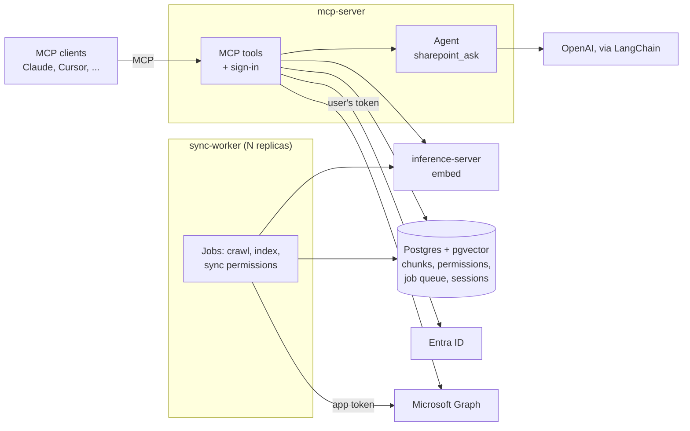
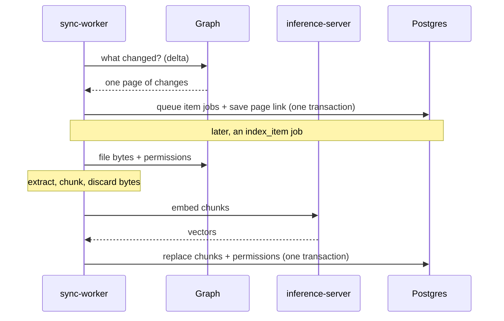
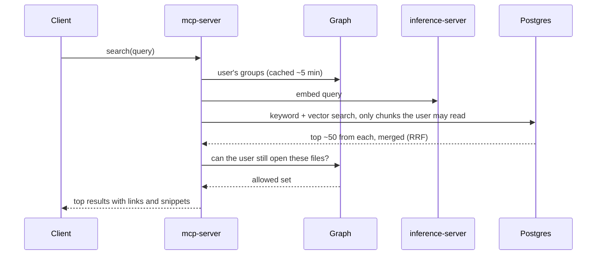
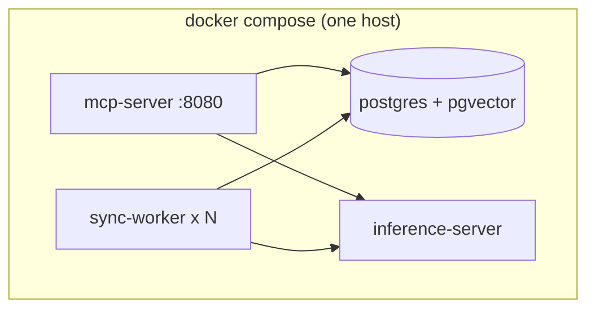

# Architecture

A search and Q&A service over SharePoint, exposed as an MCP server. Users only get content they can already open in SharePoint. It has retrieval tools and an agent tool that researches a question and returns an answer with sources.

## Goals

- **Never leak.** Results only include files the asker can open. Everything else bends around this.
- **Stay fresh.** New content shows up in minutes. Revoked access is blocked right away by a live check; group and permission *grants* can take a few minutes.
- **Search well** across English and Spanish: keyword plus meaning-based search, merged with reciprocal rank fusion.
- **Run from `docker compose up`** and scale by adding replicas.
- **Not now:** a web app, several tenants or sources, writing to SharePoint, keeping copies of the original files.

## Where we are

| Piece | State |
|---|---|
| mcp-server: Entra sign-in with all state in Postgres, `sharepoint_search` on the index (both permission layers), `sharepoint_ask`, rate limits, audit log, configurable public URL | Built (`apps/mcp-server/`) |
| sync-worker: job queue, `discover_sites`, `crawl_drive`, `index_item`, deletes, `sync_item_acl` + daily sweep, `backfill_generation`, shared Graph throttle, own app registration | Built (`apps/sync-worker/`) |
| inference-server: `/embed` over hosted Gemini (or OpenAI) | Built (`apps/inference-server/`) |
| sandbox: `sharepoint_ask`'s code interpreter, nsjail per command ([Code interpreter](code-interpreter.md)) | Built (`apps/sandbox/`), off by default (`ASK_SANDBOX`); gVisor runtime untested (no Linux host yet) |
| Index: extraction, chunking, per-language keyword search, hybrid search, generations, permission writes | Built (`packages/rag/`) |
| Live access check (`verify_access`), group lookup | Built (`packages/sharepoint/`) |
| Evals: extraction, permissions (incl. unresolved files, guests), live check, retrieval quality | Built (`evals/`); generation swaps and out-of-order permission writes are covered by DB tests |
| `Sites.Selected` permission spike, model choice with harder evals, agent answer-quality evals, webhooks | Not done (need a real tenant / an LLM-graded eval set) |

Keyword search stores each chunk in both the `simple` form (exact identifiers) and its detected language's stemmed form (English or Spanish), so "contrato" matches "contratos".

## Overview



| Component | Job | Scales by |
|---|---|---|
| **mcp-server** | Serves MCP tools, signs users in, runs searches and the agent. No state of its own (it's all in Postgres) except MCP sessions (see [Deployment](#deployment)). | More replicas |
| **sync-worker** | Copies SharePoint into the index and keeps permissions current. | More replicas, up to Graph's rate limits |
| **inference-server** | Turns text into vectors (Gemini). | More replicas |
| **sandbox** (optional) | Runs `sharepoint_ask`'s shell commands over one call's files, with no network and no secrets ([Code interpreter](code-interpreter.md)). | More memory (sessions are tmpfs) |
| **Postgres** | Everything else: search index, permissions, sync state, job queue, sessions, audit log. | Bigger machine |

The mcp-server and sync-worker share the `sharepoint_rag` and `sharepoint_client` packages but run as separate containers.

## mcp-server

A Python MCP server (the `mcp` SDK served by uvicorn) at `/api/mcp`. It also acts as its own OAuth server and passes sign-in through to Entra ([details](oauth.md)). Clients get opaque tokens from us and never see Entra tokens. We store Entra refresh tokens server-side (encrypted, see [Security](#security)).

| Tool | State |
|---|---|
| `sharepoint_search` | Built. Our index, returning cited chunks. `SEARCH_BACKEND=graph` switches back to Graph's live search. |
| `sharepoint_ask` | Built: the agent below. |
| `sharepoint_read_file`, `sharepoint_find_sites`, `sharepoint_list_drives`, `sharepoint_list_items` | Built. Always live Graph with the user's token, so they show everything the user can see, indexed or not. |
| `sharepoint_whoami`, `sharepoint_logout` | Built. |

### The agent: `sharepoint_ask`

For callers that want an answer, not raw results. The server runs its own loop, a LangGraph graph (a `model` node and a `tools` node): search, read around what it found, refine, search again, then answer with sources. The model is OpenAI's GPT-6 Luna by default (`openai:gpt-6-luna` at medium effort, with `OPENAI_API_KEY`; [measured](code-interpreter.md#cheaper-models) against Gemini 3.8 Flash, 3.5 Flash-Lite and GPT-6.1 Terra). It is created with LangChain's `init_chat_model`, so `ASK_MODEL` can name any other LangChain chat model (e.g. `anthropic:claude-opus-5-5`) once its package is installed.

- **Tools it can use** (internal, read-only): `search`, `read_around`, `read_file`, `list_items`. With `ASK_SANDBOX=local` they are `search`, `run` and `final_answer` instead: the files its searches found are in the sandbox service, search returns where each hit is in them (lines, section, best matching line) rather than its text, and `run` is a bash command (`rg`, `sed`, ...) over them, so the agent reads only the lines it needs ([Code interpreter](code-interpreter.md)). Files reach the sandbox through the same two permission layers; quotes are checked against the server's own copy of each file, never command output. `read_around` returns the indexed passages just before and after a search hit in its file. It is how the agent reads on in a PDF, which `read_file` can't open, and it often supplies what a passage needs to be understood: a parts table's title and the models it applies to sit on the page before the table.
- **Permissions:** `search` and `read_around` go through both [permission layers](#permissions). `read_file` and `list_items` call Graph with the user's token, so Graph itself refuses anything the user can't open. The agent can never get more than the user could by calling the tools directly.
- **Output:** answer text plus sources (title, link, quote, and the `sections` the quotes are in, e.g. `… > Page 401`). A source must be one the loop actually retrieved, and each quote must be in its text: whole, or as pieces in order joined with "…" (cells of a table aren't next to each other in extracted text). If a quote doesn't check out, the model is told why and gets one chance to fix it before it's dropped. The status says how much of the question was answered: `answered`, `partial` (part of it; the answer says what is missing, such as a manual the documents refer to that isn't indexed) or `not_found`, which is a valid answer. A partial answer needs a citation that checks out, or it is `not_found`.
- **Tracing:** with `LANGSMITH_TRACING=true` (see `.env.mcp.example`), each call is one `sharepoint_ask` trace: the question in; status, answer and sources out; below it each model call, and each tool call with its arguments and results (`search` and `read_around` as retriever runs). A search's query embedding is an `embed` run inside it, so the trace's cost includes it (the inference-server joins the caller's trace, see [inference-server](#inference-server)).
- **Limits:** max steps, tokens and time per call, and a per-user rate limit. It sends progress updates while working and returns what it found if it runs out of budget. Counters and token usage live in Postgres, so replicas share them.
- **Prompt injection:** documents are untrusted. A planted instruction could make the agent read other files the user can open and quote them in its answer. Mitigations: the answer is plain text, links are limited to cited sources, and the agent has no way to call out to any other URL. It still can't be made to read anything the user couldn't read.
- **Data sent out:** text the user may read goes to the model's provider (OpenAI, by default). The tool is on whenever `OPENAI_API_KEY` is set; `ASK_MODEL=none` turns it off.

## sync-worker

Keeps the index in step with SharePoint. It uses an **app token** (not a user's), so it can read everything regardless of who is signed in. It gets its **own Entra app registration**, separate from the mcp-server's, and signs in with a **certificate** rather than a client secret (SharePoint's own REST API, needed to read site group members, rejects secret-based app tokens; the private key also never leaves the worker's host). Otherwise anyone who breaks into the mcp-server (the most exposed component, and the one that runs the prompt-injectable agent) could mint tenant-wide tokens. The app token lives in the worker's own code (`sync_worker.graph`); the worker reads `.env.worker` (plus the shared `.env`, which holds no Entra credentials), its image doesn't contain the mcp-server's Entra client, and the mcp-server image and `.env.mcp` don't get the worker's certificate (`secrets/sync-worker.pem`, mounted only into the worker as a Compose secret).

**Open question: which app permission?** `Sites.Selected` (per-site grant) is the safest, but Microsoft's docs for [listing a file's permissions](https://learn.microsoft.com/en-us/graph/api/driveitem-list-permissions?view=graph-rest-1.0) list `Files.Read.All` as the lowest option and don't mention `Sites.Selected`. It might work, perhaps only with a write-level grant. Test this first: grant a test site `Sites.Selected` at `read`, then `write`, and fetch an item's permissions. If it fails, we fall back to tenant-wide `Files.Read.All`/`Sites.Read.All`, which would also let the worker find sites on its own.

Work is split into small jobs on a Postgres queue (`FOR UPDATE SKIP LOCKED`). No Celery or Redis: one less service, and jobs commit together with the data they change.

| Job | When | What it does |
|---|---|---|
| `discover_sites` | Hourly | Reads the admin's site list (`Sites.Selected` can't list sites), finds each site's drives, starts a `crawl_drive` for new ones. |
| `crawl_drive` | Every few minutes | Asks Graph "what changed since last time" (delta). For each page of changes, queues the item jobs and saves the page link in one transaction, so a crash re-reads at most one page. Only the last page gives the final cursor for the next run. |
| `index_item` | Per changed file | Skips if the file's etag is unchanged and it's already indexed in every live generation. Otherwise reads permissions, downloads, extracts, chunks, embeds, and replaces the file's chunks and permissions in one transaction, under the same "only if newer" rule as `sync_item_acl`. |
| `delete_item`, `purge_drive` | On delete, or when a site is removed | Remove the file's (or drive's) data. |
| `sync_item_acl` | From the daily sweep | Re-reads one file's permissions. |
| `sweep_acls` | Daily | Queues `sync_item_acl` for every file. Needed because delta doesn't reliably report permission-only changes. |
| `backfill_generation` | New generation | Fills a new index [generation](#index-generations). |

Rules:
- **Newest permissions win.** Every job that writes permissions (`index_item`, `sync_item_acl`, `backfill_generation`) notes when it read them from Graph and writes only if that is newer than `sources.acl_synced_at`. Otherwise a slow `index_item` that read permissions before a revocation could write the old, too-open list back until the next sweep. The timestamp is the send time of the request attempt that returned the permissions (after retries), from the worker host's clock, so keep worker clocks NTP-synced. A file whose permissions can't be read at all (403, or repeated failures) is marked `unresolved` rather than left with its last known list.
- **Rate limits.** Graph returns `429` with `Retry-After`. One shared limiter, `$batch` where possible.
- **Expired cursor (`410`).** Re-crawl the drive. Unchanged files are skipped by etag. A re-crawl can't report files deleted in the gap, so it stamps every file it sees with a `crawl_id`. Only when that full pass has reached the last page, one transaction deletes files of the drive without the new stamp. Normal delta runs return only changed files and never delete this way, and a failed or partial re-crawl deletes nothing. Old text must not linger.
- **Failures.** A bad file is marked `error`, retried with backoff, and shown to admins. It doesn't block the drive.
- **No file copies.** File bytes are read, processed and thrown away. `sharepoint_read_file` always goes live.
- **Webhooks (optional, later).** Graph change notifications could trigger an early crawl. Polling is enough to start.

## inference-server

A separate service for embeddings, so the embedding API key stays out of the sync-worker. One call: `POST /embed` (texts → vectors).

**Decision: Gemini** (`gemini-embedding-001`), with OpenAI as a second backend (`openai:text-embedding-3-small` / `-large`, through LangChain's `OpenAIEmbeddings`). Setup is just an API key and cost is per token, but **chunk text leaves our infrastructure**. OpenAI is cheaper ($0.02 and $0.13 per million tokens against $0.15) but retrieves far worse on the capability evals (2026-11-19, 1536 dimensions, hybrid search):

| | gemini-embedding-001 | text-embedding-3-small | text-embedding-3-large |
|---|---|---|---|
| FinanceBench hit@1 / wrong_filing@1 | 0.859 / 0.128 | 0.487 / 0.487 | 0.538 / 0.449 |
| Multilingual hit@1 | 0.718 | 0.578 | 0.600 |
| Identifiers hit@1 (vector alone) | 0.999 (0.865) | 0.906 (0.253) | 0.938 (0.247) |
| Synthetic, ACL scale hit@1 | 0.923, 0.990 | 0.923, 0.987 | 0.923, 0.987 |

Embedding is a small part of the cost anyway: a search query is about $0.000003, and re-embedding all 46k chunks of the local index (about 10M tokens) about $1.50 on Gemini. A self-hosted option (Hugging Face TEI with bge-m3 and a bge-reranker) was built and then removed. Bringing it back means adding a backend to `sharepoint_rag.models`. **No reranker for now:** results are ordered by hybrid RRF alone. The Gemini API has no rerank endpoint; Google's reranker is the Vertex AI Ranking API, which needs a Google Cloud project and service-account credentials. Revisit once the retrieval evals are hard enough to show whether reranking helps.

**Tracing.** With LangSmith tracing on (`LANGSMITH_*` in `.env`), each embedding request is an `embed` run with its model and token count, which LangSmith prices: Gemini's from a `countTokens` call alongside it, OpenAI's counted locally (the workspace has price entries for `text-embedding-3-*`). A caller's trace headers make the run part of that caller's trace, so a `sharepoint_ask` trace includes its searches' query embeddings; indexing batches are traces of their own. No document text is sent to LangSmith, only counts; a query's text is.

**Rate limits.** Gemini's embedding quota is per minute and counts every text, also inside a batch (Tier 1: 3,000 a minute). Each inference-server process paces itself under `GEMINI_EMBED_PER_MINUTE` (default 2,700) and keeps 10% of it for search queries, so a crawl never makes a user's search wait. When the quota runs out anyway, a short wait (≤ 10 s) is waited out; a longer one returns 429 with `Retry-After`, and the sync-worker defers the job for that long without spending an attempt or marking the file `error`. Each Gemini batch a job embedded is kept (`embedding_progress`), so the retry resumes instead of paying again, and a re-index keeps the vectors of unchanged chunks. OpenAI's quota is in tokens, so its backend paces by tokens instead (`OPENAI_EMBED_TOKENS_PER_MINUTE`, default 900k) and turns a 429 into the same deferral. **Not yet for several replicas:** each process knows only its own traffic and its own pauses. Before running more than one inference-server or sync-worker, split the quota between them and share the pause through Postgres (next to `graph_throttle`), so one replica's 429 stops the others claiming embedding jobs.

## Search index

**Decision: Postgres with pgvector and full-text search, behind a `Retriever` interface.**

Why:
- **It's already built**, with passing permission evals.
- **One transaction.** Replacing a file's chunks and permissions together can't leave stale, too-open permissions behind. A separate search engine would need two writes and a repair job, which is the failure we're designing against.
- **One less system** to run, secure and back up.

Rough size: 1M chunks at 1536 dimensions is about 6 GB of vectors with today's `vector` type, or 3 GB with `halfvec` (needs a migration), plus similar for the HNSW index. A tenant with 100k documents is around 1M chunks. That fits one Postgres.

Revisit if we measure one of these:
1. **Keyword quality is the limit** (exact IDs, Spanish word forms). First pick the text config per chunk by language, then try a BM25 extension (ParadeDB `pg_search`, VectorChord).
2. **Too slow, or poor recall** for users who can see few files.
3. **Over about 5M chunks**, or indexing outgrows one Postgres.

If so, OpenSearch is the likely next step, with Postgres still the source of truth. This is not planned work.

### Index generations

Changing the embedding model invalidates every vector, so the index is versioned. A generation is **live** if its status is `building` or `active`.

1. Each generation has its own chunk table (`chunks_g<N>`) because pgvector columns have a fixed size.
2. `backfill_generation` fills a new one from chunk text already stored, with no re-download. It takes each file's permissions from `sources.acl` at write time, not from a copy. The old generation keeps serving.
3. Every permission write goes to all live generations in one transaction.
4. A generation goes `active` only when a check finds no chunks with permissions that differ from `sources.acl` and no indexed file missing from it. Then one config flip switches over.

## How data flows

### Ingest



### Search



Rough timing (estimates, not measurements): embed query 50-150 ms, search tens of ms, Graph check 200-500 ms. The Graph check is the slowest part and is the price of the stronger guarantee.

## Permissions

Each chunk stores an **ACL**: the Entra user IDs, group IDs and markers (like `org:members`) that can read its file. A user's **principals** are their own ID, their groups (including nested), and `org:members` if they're a full member.

**Layer 1: filter inside the search.** A chunk is visible only if its ACL overlaps the user's principals. The filter is part of the query, so hidden chunks never enter ranking. `Retriever` requires principals, so there's no unfiltered path.

**Layer 2: live check.** The index can lag SharePoint, so the final results are checked against Graph with the user's own token. Anything they can't open is dropped. If the check itself fails, return nothing.

Groups are looked up at query time (cached up to ~5 minutes), so joining or leaving a group needs no re-indexing. A new member sees the group's files up to 5 minutes late, because layer 2 can drop results but never add them. A removed member may still match in layer 1 for that long, but layer 2 drops those files at once. The lookup is `/me/transitiveMemberOf`, which Microsoft documents as needing only the `User.Read` the app already has; every returned object id is kept, so objects Graph returns without a type under that scope still count. More scopes can be added with `GRAPH_EXTRA_SCOPES`. If the lookup fails, show an error. Never search with a partial list, because group-shared files would silently vanish.

Hard cases:
- **Guests.** They never get `org:members`, so "anyone in the organization" links don't reach them. SharePoint's "Everyone" claim (which does include guests) is stored as `org:everyone`, held by every signed-in user.
- **Anonymous links.** Stored as `org:anonymous`, which nobody has. Such files are found only through their other grants.
- **SharePoint site groups.** Most team-site files are shared through the site's Owners/Members/Visitors groups, which Graph lists but doesn't expand. The worker reads their members from SharePoint's REST API (`sync_worker.directory`) and maps them to Entra users (UPN → id), Entra and Microsoft 365 groups, Microsoft 365 group owners (listed through Graph, since a token's groups claim covers membership, not ownership) and the everyone claims. Answers are cached for 10 minutes. Membership changes don't touch files, so delta misses them, and the daily sweep picks them up; a removal is caught by layer 2 right away. A group whose members can't be read, or with any member we can't map, leaves the file `unresolved`.
- **Unusual links and other unknown grants.** If we can't resolve a file's permissions, mark it `unresolved` and show it to nobody. A metric tracks how many.
- **Stale text.** Layer 2 only checks that the file can still be opened. Snippets come from the indexed copy, so text the author just removed, or a file stuck in `error`, can still be served until it's re-indexed. The delay is bounded by the crawl interval (and for `error` files, by retries, then the daily sweep, which re-queues them), not by layer 2.
- **Permission-only changes.** Delta may miss them, so the daily sweep catches up. A missed revocation is caught by layer 2 right away. A missed grant just shows up late.
- **Many groups.** Thousands of groups per user is fine for Postgres in theory but needs a test.
- **The index is sensitive.** It holds everything the crawler can read. Encrypt the disk, isolate the network, and let only the mcp-server read it.

## Data model

All of this is in `schema.sql` (tables marked *new* were added with the sync-worker); chunk tables are created per generation by `sharepoint_rag.generations`.

```
sites            (new)  id, name, web_url, enabled              -- admin-managed list
drives           (new)  id, site_id, name, enabled
sync_state              drive_id, delta_link, synced_at, next_link (new), last_error (new)
sources                 drive_id, item_id, site_id, web_url, name, etag, modified_at,
                        indexed_at, status, status_note, acl_hash,
                        acl (new, source of truth), acl_status (new: resolved | unresolved),
                        acl_synced_at (new), language (new), last_crawl_id (new)
source_generations (new) source_id, generation_id, etag
index_generations  (new) id, model, dimensions, status          -- building | active | retired
chunks_g<N>             source_id, ordinal, text, heading_path, embedding, tsv, acl, metadata
jobs               (new) id, kind, payload, run_at, attempts, locked_by, state, last_error
oauth_clients      (new) client registrations
oauth_tokens       (new) hashed opaque tokens -> Entra account, expiry
msal_cache         (new) encrypted per-user Entra token cache
usage_limits       (new) per-user counters for rate limits
audit_log          (new) ts, user_id, action (search/read/ask/login), query HMAC,
                        result source ids, tokens used
```

`sources.acl` is the source of truth, copied onto each chunk so the search filter is one indexed check. A permission-only change updates the `acl` column without re-embedding.

## Deployment



- **Single user.** `docker compose up`: all four services, `mcp-server` on loopback only.
- **Team (not set up; everything is localhost for now).** The same plus an HTTPS proxy in front of the mcp-server (see [Setup](setup.md#team-use-not-set-up)):
  - `PUBLIC_URL` sets the OAuth issuer, resource URL and Entra redirect URI;
  - OAuth state, signed-in accounts and the encrypted Entra token cache are in Postgres;
  - MCP sessions live in one process's memory. Either route each client to the same replica (sticky routing), or set `MCP_STATELESS=true`. Prefer sticky routing, since agent progress updates need a long-lived connection;
  - client registration only to loopback or operator-allowed redirect URIs, a separate app registration for the sync-worker, per-user rate limits. Secrets in a secret store is up to the deployment.
- **Scale.** `mcp-server` and `sync-worker` are stateless, so add replicas. Graph's rate limits cap the sync-worker. `inference-server` scales on its own and is where a GPU helps first.

## Security

- Users sign in with their own Entra identity. App-level credentials exist only in the sync-worker, under a separate Entra app registration (with a certificate) from the mcp-server's. Their scope depends on the [open permission question](#sync-worker): it may end up tenant-wide read.
- Permission checks fail closed: layer 2 errors, failed group lookups and unresolved permissions all return nothing.
- Client tokens are opaque, hashed, short-lived and rotated. The server holds Entra refresh tokens in an encrypted cache with a key kept outside the database. A database leak plus that key would expose every signed-in user's access, so guard the key.
- No original files are stored. The audit log keeps a keyed HMAC of each query (a plain hash of a short query can be guessed) plus result IDs, not content. Still treat it as sensitive.
- Text may leave our infrastructure only through the embedding API (Gemini by default) and the `sharepoint_ask` model provider (OpenAI by default), once `GEMINI_API_KEY` and `OPENAI_API_KEY` are set; `ASK_MODEL=none` turns the agent off. With LangSmith tracing on, the agent's trace holds what it read; embedding traces hold counts only, and a search query's text.

## Quality checks

- The permission and verification evals must stay at 1.0 through any change to search or permission sync. Add cases for unresolved permissions, group changes, guests, out-of-order permission jobs and generation swaps.
- The retrieval dataset is 10 documents, so vector search already scores 1.0 and can't show improvements. Add harder cases before tuning anything.
- The agent needs answer-quality and groundedness evals. The current evals deliberately use no LLM.
- Watch: sync lag per drive, queue depth and errors, files by `status` and `acl_status`, Graph 429 rate, embed latency, how often layer 2 drops results (a spike means stale permissions), agent token use.

## Build order

1. **Index and base permissions.** First the permission spike. Then the sync-worker (`discover_sites`, `crawl_drive`, `index_item`, deletes, job queue), with permissions read in the same transaction as the chunks. Ship with the full query-side permission model: group lookup and consent, `org:members` for members only, guest handling, fail on lookup error. Only then point `sharepoint_search` at the index.
2. **Permission freshness.** `sync_item_acl`, daily sweep, unresolved handling, new evals.
3. **Inference-server.** `/embed` on OpenAI or Gemini, index generations.
4. **Multi-user server.** OAuth state and token cache in Postgres, restricted registration, audit log, rate limits. HTTPS for team use is not set up yet.
5. **Agent.** `sharepoint_ask` with budgets, rate limits and answer evals.
6. **Optional.** Graph webhooks for faster updates.

Steps 1 and 2 come first. Nothing else is worth much until the index is fresh and its permissions are right.

## Open questions

- **App permission** for reading item permissions (see [sync-worker](#sync-worker)). Blocks step 1.
- **Site list:** today `SYNC_SITES` plus `python -m sync_worker sites add|disable`, or `SYNC_DISCOVER_ALL_SITES=true` with tenant-wide read. An admin page is not built.
- **Unresolvable permissions:** hidden by default; `UNRESOLVED_ACL_POLICY=live_check` allows them with only the live check (more results, weaker guarantee). Site groups are now expanded, so what's left is unusual: watch the `unresolved` count in `sync_worker status` on a real tenant before deciding.
- **More file types:** old `.doc`/`.ppt`, scanned PDFs (OCR), SharePoint pages and lists, OneNote, Teams. Pages and lists need other Graph endpoints.
- **Cleanup after delete:** how long deleted or revoked content may remain in logs and caches.
