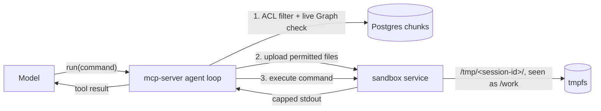

# Code interpreter for sharepoint_ask

Proposal, 2026-11-19. Built behind `ASK_SANDBOX=local` (off by default). Measured on, with search returning only where its hits are: 45% cheaper per question, answering about as many questions ([Measurements](#measurements)).

## Summary

`sharepoint_ask` spends 94% of its tokens re-sending passages it has already read, and still misses facts that a plain text search of the right manual would find. A code interpreter fixes both: the user's permitted files sit on disk outside the model, and only the output of commands like `grep` and `sed` enters the conversation.

Recommendation: build it locally as a separate sandbox service with no network, holding each request's files under `/tmp/<session-id>/`, and only the files that user can open. Keep its interface small (add files, run a command, delete the session) and shaped like Azure Container Apps dynamic sessions, so Azure can replace the local sandbox later without changing the agent.

Gemini's built-in code execution doesn't solve the problem: files attached to it count as input tokens ([Code execution](https://ai.google.dev/gemini-api/docs/code-execution)).

## Current problems

The agent pays for the same pages again and again. On 2026-11-19, its model calls used 5.31M input tokens against 0.32M output tokens: 94% of tokens were context re-sent on every step, not new work. The model keeps no memory between calls, so each step re-sends the question plus every passage gathered so far. By step 8, a single call carries about 32k tokens.

| Problem | Evidence (2026-11-19) | Why it happens |
| --- | --- | --- |
| Context piles up | 5.31M input vs 0.32M output tokens across 833 model calls | Each search adds up to 10 passages of up to 1,500 characters (`MAX_CHARS`), about 4k tokens with their JSON, and every later step re-sends them |
| Hard questions cost the most | Dead ends and comparisons used 98–172k tokens, a direct lookup 11k (table below) | The agent keeps searching, and every extra step re-sends the whole pile |
| Facts that search ranks low get missed | The M1008 oil capacity ("Crankcase capacity is 7 quarts with filter", TM 9-2320-289-20, Page 56) was found in 1 of 3 runs | A direct search ranks it 7th; the page says "CUCV", never "M1008", and the agent usually asks for 5 results |
| Exact lookups return whole passages | A stock-number lookup returns 1,500-character slices of parts tables when one line answers it | Search only returns whole passages; there is no line-level tool |
| Dead ends use up the budget | One M939 run hit the 8-step limit with no answer | Nothing tells the agent a term isn't in the files; it rephrases and searches again |

Tokens per question, one live run each (LangSmith, `normabot-local`):

| Question | Status | Tokens | Cost |
| --- | --- | ---: | ---: |
| HMMWV clutch roller + Abrams oil capacity | partial | 171,941 | $0.049 |
| M939 clutch roller | not_found | 155,827 | $0.048 |
| Abrams turbine maintenance | not_found | 98,868 | $0.032 |
| M998 vs M1008 oil capacity | not_found | 97,429 | $0.031 |
| M998 tire pressure | answered | 23,148 | $0.024 |
| M815 propeller shaft | answered | 11,381 | $0.015 |

Cost doesn't scale with the token column. Output and thinking tokens cost several times more than input, and input Gemini serves from its cache costs less, so a short run that writes a long answer (tire pressure) costs nearly as much as a long run that mostly re-reads cached passages (the oil comparison). The input tokens are still where the waste is: they are the part that grows with every step.

Already fixed today: exact matches in hybrid search, both spellings of stock numbers, reading the pages around a hit (`read_around`), quote checks, the `partial` status, and a forced answer on the last step. The problems above remain because search is the agent's only way to look at a file.

## How a code interpreter helps

The model decides how much text comes back. That's how Claude Code stays cheap on large codebases: it runs `grep -n`, gets one line, then reads only the 20 lines it needs. A grep hit costs about 50 tokens; a search result costs about 400.

The saving only lasts if old output stops being re-sent. Every `run` result comes back through another model call, and that call carries the whole conversation, so many small probes could cost more than a few searches. The agent therefore keeps only the latest few command outputs in full (see step 5).

| Problem | With a code interpreter |
| --- | --- |
| Context piles up | Files stay on disk; only command output enters the conversation, capped per call |
| Hard questions cost the most | Cheap probes (`grep -c`, `grep -l`) settle whether a term exists before any page is read |
| Facts that search ranks low get missed | The page ranks 7th, so its manual is in the session (step 2); `rg -i -U "crankcase\s+capac"` finds the line on Page 56 whatever the page calls the vehicle, even across a line break |
| Exact lookups return whole passages | One matching line per hit, with its file and page |
| Dead ends use up the budget | A few `grep -c` probes for the key terms cost little, so the agent learns quickly that a term is rare or absent and can say so instead of rephrasing searches |

Grep only sees the files in the session. By default those are the manuals search points at (step 2), so a fact in a file that no search ever ranks in its top 50 stays out of reach, as today; only the "every permitted file" option (open questions) closes that gap.

Zero grep hits is evidence, not proof. Extracted PDF text breaks lines mid-phrase ("crankcase\ncapacity"), which a pattern with `\s+` and `rg -U` handles but a plain `grep "crankcase capacity"` misses; manuals spell the same thing several ways, scanned pages may have no text, and a file indexed only partly (cut off at 5,000 pages) or not at all isn't fully on disk. The agent should treat no hits as "not found in what I could read", try a looser pattern or search, and never conclude more than that.

It adds to search rather than replacing it. Grep can't match a question phrased differently from the manual, or a Spanish question about an English manual. Search stays the way in; the interpreter is how the agent reads, checks and compares once it knows where to look.

It also makes some questions possible for the first time: counting parts across figures, listing every capacity in a table, or comparing two manuals line by line, with a short script instead of many reads.

## Options considered

| Option | Keeps files out of context | Permissions | New risk | Verdict |
| --- | --- | --- | --- | --- |
| Gemini built-in code execution | No: attached files are input tokens, up to the context window | Whole files uploaded to the Files API, kept 48 hours, shared across the Google project | More document text sent to Google than today | Rejected |
| `grep` and `read_lines` tools over the index (no shell) | Yes | Same SQL ACL filter as search | None: no code runs | Good first step; no scripts or pipelines |
| Local sandbox service (this proposal) | Yes | Only files that pass both permission layers are written to the session | Model-written commands run on our side; contained by the sandbox below | Recommended |
| Azure Container Apps dynamic sessions | Yes | Same files, uploaded to an isolated Azure session | Same as local, isolation handled by Azure | Later, for production |

Gemini's limits: the largest attachable file is bounded by the model's token window, each code run is capped at 30 seconds, and the tool works best on text and CSV ([Code execution](https://ai.google.dev/gemini-api/docs/code-execution), [File input methods](https://ai.google.dev/gemini-api/docs/file-input-methods)).

## Local code interpreter

A new Compose service, `sandbox`, runs commands for the agent. The mcp-server never runs model-written code itself: it is the most exposed component and holds the Entra client and user tokens.

### Steps

1. **Session id.** At the start of each `sharepoint_ask` call, the server creates a random id (`uuid4`). It is never taken from the model or the MCP client, and never shown to either: whoever knows a session id can read its files. Commands never see it either. The sandbox stores the session under `/tmp/<session-id>/`, and each command runs in a private mount namespace whose only writable folder is that session's, mounted at `/work` (as Azure uses `/mnt/data`). The namespace has its own `/proc` and its own empty `/tmp`, so `pwd`, `ls /tmp`, `/proc/self/mountinfo` and error messages show `/work`, never the id or other sessions' folders.
2. **Pick the files.** The files are the user's permitted sources: chunks that pass the principals/ACL filter in SQL (layer 1), then a live Graph check that the user can still open each file (layer 2). By default the session holds every file with a chunk among each search's top 50 candidates (the pool hybrid search already ranks), not only the top results shown to the model. That is what puts the M1008 manual on disk: its page ranks 7th, outside the 5 results the agent asked for. Writing every permitted file would mean a Graph check and a file build per file on every call, which risks Graph throttling (429) and the 120 s timeout on a real tenant (see open questions). The live check reuses `graph.verify_access`, which already sends `$batch` requests of 20, retries throttled items and fails closed.
3. **Build the text.** Each file is written from the index, not downloaded again: its chunks in `ordinal` order, with a marker line per section taken from `heading_path`, e.g. `=== Page 401 ===`. Neighbouring chunks of the same section repeat some text: the next chunk starts with up to `OVERLAP_CHARS` (200) characters of the previous one, cut at a word, and not always (the first chunk of a section has none, and the overlap is skipped when it would make a chunk too long; `chunk.py`). The builder therefore drops, within a section only, the longest start of each chunk that matches the end of the previous chunk, and drops nothing when there is no match. Cutting a fixed 200 characters would delete real text. PDFs are already extracted, and the text is the same text search returns. Line breaks are kept, since they separate table rows. The server keeps the built text of each file for the rest of the call.
4. **Register and upload.** Every file written to the sandbox is registered as a source in the agent loop, with an `S`-id, exactly as if a search had returned it, so the agent can cite a file it only found through `grep`. The file is named by that id, `/work/S7.txt`, never by its SharePoint name: names collide across drives and folders, and a name starting with `-` would be read as an option. `/work/manifest.tsv` maps each id to its title and link. The files of a search's hits are uploaded during that search, because the result points into them (below). The files ranked below the hits wait for the agent's first `run`, and files that later searches find are added as they arrive.
4a. **Search returns where, not what.** With the sandbox on, `search` gives no passage text. For each file it lists the hits, best first: the lines each hit is on in `S<n>.txt` (`"lines": "2015-2040"`), its section without the document title (`"Page 56"`), and up to 200 characters of the hit's lines that contain most of the query's words. The model then reads what it needs with `sed -n '2015,2060p' S7.txt`, often a few lines above the hit, where a table's title is. It also gets `other_files`: up to 8 of the files ranked below the hits, by title, plus a count of the rest. If a hit's file can't be written (the sandbox is busy or down), that hit comes back as a passage with its text, as without the sandbox. The agent's tools are then just `search`, `run` and `final_answer`: `sed` and `rg` do what `read_around` and `read_file` did. Passages were most of what every step re-sent, and the first search result shrank from about 6k tokens to about 1.3k.
5. **Run.** The agent gets one new tool, `run(command)`. The sandbox runs it with `bash -c` in `/work` and returns stdout and stderr, capped at 4,000 characters with a note to narrow the command (e.g. `[cut: 18,230 more characters; use grep -m or head]`). Each `run` is a step, because each one costs a model call that re-sends the conversation. `ASK_MAX_STEPS` stays 8 with the sandbox on (14, as proposed, measured 56% dearer for one more answer), and the step budget is the only cap on `run`. Two rules keep that affordable:
   - **Every output stays.** The proposal kept only the last 3 `run` outputs in full and stubbed older ones. Measured, that cost more than it saved: rewriting an earlier message changes the conversation's prefix, so Gemini's implicit cache reads nothing after it, and each later step pays full price for the whole conversation ($0.093 a question against $0.061 keeping everything, see [Measurements](#measurements)). The 4,000-character cap and the step budget bound the growth instead.
   - **The last step stays cached.** A last step that doesn't call final_answer is first told it was the last, with the usual tools, so Gemini still reads the conversation from its cache. Only if it still doesn't answer is it called with `tool_choice=final_answer`, which changes the tool config and gets no cache.
   - **Commands fit the timeout.** The per-command wall clock is 5 s, and `run` is refused once the call has used 80% of `ASK_TIMEOUT_SECONDS` (120 s), the same rule that forces the last answer today. Building and uploading the files counts toward that time.
6. **Cite.** Quotes are checked against the text the server built in step 3, never against `run` output. Command output is whatever the command prints: `echo "Crankcase capacity is 12 quarts"` would otherwise make any quote pass. The source must be a registered one. The check runs on the file's text with the marker lines removed, so a quote that runs across a page break still matches. Its section is the last marker before the quote's start, not the nearest one: a quote just above `=== Page 56 ===` is on Page 55.
7. **Clean up.** The server deletes the session in a `finally` when the call ends. The sandbox also removes any session idle for more than 15 minutes (a crashed request), and `/tmp` is a tmpfs, so a restart leaves nothing.

### The sandbox service

- **Interface:** `POST /sessions/{id}/files`, `POST /sessions/{id}/execute`, `DELETE /sessions/{id}`, authenticated with a shared key the way the inference-server is (`INFERENCE_API_KEY`). Azure dynamic sessions have the same three operations: file upload, code execution, and stop session.
- **Image:** a slim Linux image with `bash`, coreutils, `grep`, `ripgrep`, `sed`, `awk` and `python3` (standard library only). Nothing can be installed at run time.
- **Network:** the service's API listens on an `internal: true` Compose network shared with the mcp-server, so it has no route to the internet, Postgres or Graph. That network still reaches the mcp-server, and `python3` can make HTTP requests, so commands get no network at all: each runs in its own network namespace holding only a loopback interface (e.g. `unshare --net` or `nsjail`). Only the service's own API process is on the Compose network.
- **No secrets:** no environment variables, no tokens, no mounted credentials.
- **Isolation between sessions:** each session runs as its own Unix user from a pool (e.g. uid 20000–20999), its folder is mode `0700`, and each command sees only its own folder at `/work`, so one session can't read another's files.
- **Limits per command:** 10 s of CPU, 512 MB of memory, 64 processes, 50 MB of written files, and a 15 s wall clock; at most 4 commands at once. Limits per session: 112 MB of files (the server sends at most 96 MB) on a 160 MB tmpfs; at most 10 sessions, so all of it fits the container's 4 GB.
- **Filesystem:** `/tmp` is a tmpfs with a size cap; everything outside it is read-only. Commands see only `/work` (step 1).
- **Privileges:** network and mount namespaces per command, and switching to a uid from the pool, need privileges a default Docker container doesn't have. Without them, `unshare` fails with EPERM, since Docker's seccomp profile blocks it. The container needs `cap_add: [SYS_ADMIN, SETUID, SETGID, CHOWN]` and a seccomp profile that allows `unshare` and `mount`, which is more power than this service should have on the host kernel. So the sandbox container runs under gVisor (`runtime: runsc`). gVisor gives it its own user-space kernel, so those privileges, and anything a command escapes into, stay inside gVisor rather than on the host. Running `nsjail` as the per-command jail inside it keeps the namespace, uid and limit setup in one tool. Without gVisor (e.g. Docker Desktop on a Mac, where it isn't available), `ASK_SANDBOX=local` is for development only.

### Agent changes

- **Tool:** `run(command)`, described as "Run a shell command over the files in /work: one `S<n>.txt` per source, plus `manifest.tsv` with their titles. Cite a file by its S-id."
- **Prompt:** prefer `rg -n -i -m 20` to find things, with `\s+` between words and `-U` so a phrase broken across lines still matches, `sed -n 'A,Bp'` to read a range, and `grep -c` or `grep -l` to check that something exists. Use search for questions in other words or another language. Zero hits means only that the pattern isn't in these files as written: try a shorter or looser pattern, or search, before saying the answer wasn't found.
- **Setting:** `ASK_SANDBOX=off|local|azure`, off by default until the evals below pass.
- **Tracing:** each `run` call is a `tool` run in LangSmith with the command as input and the capped output as output, like today's tools.

## Security and permissions

- **Both permission layers still apply.** A file reaches the sandbox only after the ACL filter and the live Graph check, the same rules as `search` and `read_around`. The agent can't read anything the user couldn't.
- **Prompt injection.** Documents stay untrusted. A planted instruction could make the agent run commands, but only inside a sandbox with no network and no secrets, over files the user may read anyway. The ways out stay what they are today: the answer is plain text, and its links are limited to cited sources.
- **Forged quotes.** A command can print any text, so quotes are checked only against the server's own copy of each file, never against command output.
- **Resource abuse.** A planted instruction could ask for an expensive command. The per-command limits stop it, and each `run` counts against the step, token and time budgets.
- **Sandbox escape.** Commands are written by a model that reads untrusted documents, so the sandbox assumes they are hostile. gVisor is the outer wall, nsjail the inner one, and the container holds no secrets and has no route out.
- **Data sent out.** Unchanged for the local sandbox: files stay on our machine, and only command output goes to the model's provider.
- **Tests to add before turning it on:** a session only ever holds the user's permitted files; one session can't read another's folder; commands can't reach the network, including the mcp-server; a quote printed by `echo` is rejected; a file found only by `grep` can be cited; command output never contains the session id, including from `ls /tmp` and `/proc/self/mountinfo`; a built file holds every chunk's text exactly once; a quote across a page marker passes and gets the page it starts on; every limit holds; output is capped; sessions are deleted at the end of a call and after a crash. Add sandbox cases to the `acl_regression` and `agent_safety` evals.

## Azure code interpreter, later

Azure Container Apps dynamic sessions provide the same three operations as a managed service, with each session in its own isolated sandbox.

- **Backend swap:** one `Sandbox` interface with two implementations, `LocalSandbox` (the service above) and `AzureSessionsSandbox`, chosen by `ASK_SANDBOX`. The agent and the file-building steps don't change.
- **Session pool:** a pool in the same region as the rest of the deployment. A shell session pool (preview) runs the same commands as locally; a Python code-interpreter pool would mean the agent writes Python instead of shell ([shell sessions](https://learn.microsoft.com/en-us/azure/container-apps/sessions-tutorial-shell), [code interpreter sessions](https://learn.microsoft.com/en-us/azure/container-apps/sessions-code-interpreter)).
- **Session id:** the same server-generated `uuid4`, passed as the session identifier. Azure warns that anyone with access to a session can read its files and environment, so the id stays server-side, as locally ([session usage](https://learn.microsoft.com/en-us/azure/container-apps/sessions-usage)).
- **Files:** uploaded through the session's files API, with the same `S<n>.txt` names; they land in `/mnt/data` instead of `/work`, and the tool description names that folder. Each file can be up to 128 MB ([Upload API](https://learn.microsoft.com/en-us/rest/api/data-plane/containerapps/session-resource-files/upload?view=rest-data-plane-containerapps-2025-10-02-preview)).
- **Network:** egress is disabled by default; keep it disabled.
- **Auth:** the mcp-server's managed identity calls the pool with an Entra token and the "Azure ContainerApps Session Executor" role on the pool. No shared key.
- **Lifetime:** the server ends each session when the call ends, with `POST {poolManagementEndpoint}/.management/stopSession?identifier=<id>` (2025-10-02-preview; the session pool docs also list a `DELETE` session endpoint). The pool's idle cooldown (300–3600 s) replaces the local 15-minute sweep for crashed requests ([custom container sessions](https://learn.microsoft.com/en-us/azure/container-apps/sessions-custom-container), [session pools](https://learn.microsoft.com/en-us/azure/container-apps/session-pool)). Check before building that the stop call works for the pool type chosen: the docs show it for custom container pools.
- **Data residency:** files go to our own Azure subscription, not to the model provider.

## Rollout and evaluation

1. Build `run`, the local sandbox and the file builder behind `ASK_SANDBOX=off`.
2. Add the security tests above; the regression tier must still score 1.0.
3. Run the six questions above live, plus the oil comparison 3 times, with the sandbox on and off. Compare tokens, steps, status and citations. This costs about $1.
4. Run the agent eval tier (`answer_quality`, `agent_safety`, golden), about $3–4 per pass at today's rates. Turn the sandbox on only if answers hold or improve and tokens fall.
5. Add `AzureSessionsSandbox` when the service moves to Azure.

## Measurements

Six live questions, 3 runs each, `gemini-3.8-flash`, mean cost per run as LangSmith prices each trace. "Before" is the code before this work. The other three columns are the final code: the same agent with the sandbox off, and on with 14 or 8 steps.

| Question | Before (8 steps) | Final, sandbox off (8) | Final, sandbox on (14) | Final, sandbox on (8) |
|---|---|---|---|---|
| 1. HMMWV clutch roller + Abrams oil | $0.058 | $0.037 | $0.064 | $0.049 |
| 2. M939 clutch roller | $0.061 | $0.053 | $0.071 | $0.043 |
| 3. Abrams turbine interval | $0.049 | $0.035 | $0.056 | $0.032 |
| 4. M998 vs M1008 oil | $0.061 | $0.042 | $0.056 | $0.029 |
| 5. M998 tire pressure | $0.027 | $0.032 | $0.052 | $0.031 |
| 6. M815 propeller shaft | $0.016 | $0.018 | $0.035 | $0.030 |
| **Mean** | **$0.046** | **$0.036** | **$0.056** | **$0.036** |
| Answered (of 18) | 7 | 6 | 11 | 10 |

- **Sandbox on, 8 steps, is the best trade:** 22% cheaper than before, and it answers 10 of 18 questions, not 7. Question 2 (M939 clutch roller) went from partial in every run to answered in some, and question 4 from 1 of 3 to 3 of 3. With 14 steps it answers one more question but costs 56% more than with 8. So with the sandbox on, `ASK_MAX_STEPS` defaults to 8.
- **Sandbox off is just as cheap now** ($0.036), from the cached last step below, but it answers less.
- **Simple questions (5, 6) cost more with the sandbox.** Search alone answers them, and the sandbox's prompt and tool, plus the model trying `run` anyway, add $0.004–0.012.

What changed from the proposal, and why:

- **Every output stays.** Keeping only the last 3 `run` outputs, as proposed, cost $0.093 a run against $0.061 keeping all of them (earlier code, 14 steps). Rewriting an earlier message changes the conversation's prefix, so Gemini's implicit cache reads nothing after it.
- **The last step stays cached.** Forcing `tool_choice=final_answer` changes the request's tool config, and Gemini then serves none of the conversation from its cache: that one call was $0.025–0.038, up to 40% of a run. The last step is now asked with the usual tools first, and forced only if the model doesn't answer.

### Search that returns only where the hits are

The run above still put every search's passages into the conversation. With search returning the file list instead (step 4a), measured the same way and in the same hour as a sandbox-off control:

| Question | Before | Sandbox off | Sandbox, passages (8) | **Sandbox, file list (8)** | Sandbox, file list (10) |
|---|---|---|---|---|---|
| 1. HMMWV clutch roller + Abrams oil | $0.058 | $0.045 | $0.049 | $0.030 | $0.037 |
| 2. M939 clutch roller | $0.061 | $0.045 | $0.043 | $0.029 | $0.035 |
| 3. Abrams turbine interval | $0.049 | $0.033 | $0.032 | $0.020 | $0.027 |
| 4. M998 vs M1008 oil | $0.061 | $0.042 | $0.029 | $0.025 | $0.029 |
| 5. M998 tire pressure | $0.027 | $0.033 | $0.031 | $0.024 | $0.030 |
| 6. M815 propeller shaft | $0.016 | $0.016 | $0.030 | $0.023 | $0.031 |
| **Mean** | **$0.046** | **$0.036** | **$0.036** | **$0.025** | **$0.032** |
| Answered (of 18) | 7 | 8 | 10 | 8 (two runs: 8, 8) | 9 |
| Median tokens per question | | ~47k | ~85k | ~24k | ~31k |

The file-list column is the mean of two 18-run benches ($0.024 and $0.026).

- **Cost: $0.025 a question, 45% below before**, and 30% below both the sandbox-off agent and the passages version, with half the tokens. The first search result is ~1.3k tokens instead of ~6k, and the prompt stays under ~8k tokens to the last step.
- **Answers: about as before** (8 of 18 against 7), and below the passages version (10). The runs vary a lot: the same question is answered in one run and not found in the next. In the traces, the model spends steps working out which manual covers which vehicle (`cat manifest.tsv`); titles are TM numbers. Giving it the vehicles each manual covers is the next quality step.
- **10 steps aren't worth it:** +26% cost for one more answer.

### Cheaper models

#### Gemini 3.5 Flash-Lite

Flash-Lite costs $0.30 / $0.03 cached / $2.50 per million tokens, against `gemini-3.8-flash`'s $0.75 / $0.075 / $3.75. Here are its thinking efforts (`reasoning_effort`) with the file-list sandbox at 8 steps, run in the same hour as a `gemini-3.8-flash` control. "Cited" counts answers whose quote the server verified. An answer without one is the model writing plain text instead of calling `final_answer`, or citing nothing.

| Question | 3.8 Flash | Lite minimal | **Lite low** | Lite medium | Lite high | **Lite low, sandbox off** |
|---|---|---|---|---|---|---|
| 1. HMMWV clutch roller + Abrams oil | $0.027 | $0.009 | $0.010 | $0.015 | $0.013 | $0.012 |
| 2. M939 clutch roller | $0.025 | $0.008 | $0.011 | $0.014 | $0.014 | $0.008 |
| 3. Abrams turbine interval | $0.022 | $0.008 | $0.007 | $0.007 | $0.010 | $0.006 |
| 4. M998 vs M1008 oil | $0.027 | $0.011 | $0.011 | $0.013 | $0.015 | $0.013 |
| 5. M998 tire pressure | $0.026 | $0.010 | $0.005 | $0.011 | $0.015 | $0.010 |
| 6. M815 propeller shaft | $0.023 | $0.013 | $0.006 | $0.011 | $0.013 | $0.004 |
| **Mean** | **$0.025** | **$0.010** | **$0.008** | **$0.012** | **$0.013** | **$0.009** |
| Answered (of 18) | 10 | 7 | 8 | 8 | 12 | 12 |
| Cited (of 18) | 10 | 6 | 8 | 2 | 7 | 9 |

- **Low effort is the best Flash-Lite setting:** $0.008–0.009 a question, a third of `gemini-3.8-flash` and 82% below before, with or without the sandbox. More thinking costs more without more cited answers: medium and high often answer in plain text, which the server can't verify. Minimal thinks less per step but takes more steps.
- **Quality is a little lower:** 8–9 cited answers against 10. Question 4 (comparing two manuals) is the weak one with the sandbox.
- **With Flash-Lite the sandbox no longer saves anything:** sandbox off answers as cheaply ($0.009 vs $0.008) and cites slightly more (9 vs 8). Prices this low leave little for the sandbox to save on 6 questions with small result sets. Its case is now larger files and table work, not cost.

#### OpenAI: GPT-6 Luna and GPT-6.1 Terra

The same bench at medium effort, sandbox off, against the Flash-Lite column above. Luna is $0.10 / $0.01 cached / $0.50 per million tokens, Terra $1 / $0.05 / $5.

| Question | Flash-Lite low | **GPT-6 Luna** | GPT-6.1 Terra |
|---|---|---|---|
| 1. HMMWV clutch roller + Abrams oil | $0.012 | $0.006 | $0.089 |
| 2. M939 clutch roller | $0.008 | $0.005 | $0.075 |
| 3. Abrams turbine interval | $0.006 | $0.004 | $0.041 |
| 4. M998 vs M1008 oil | $0.013 | $0.002 | $0.037 |
| 5. M998 tire pressure | $0.010 | $0.001 | $0.012 |
| 6. M815 propeller shaft | $0.004 | $0.001 | $0.014 |
| **Mean** | **$0.009** | **$0.003** | **$0.045** |
| Answered / cited (of 18) | 12 / 9 | 9 / 9 | 9 / 9 |
| Median seconds | | 16 | 15 |

- **Luna is the default now** (`openai:gpt-6-luna`, `reasoning_effort: medium`): $0.003 a question, 63% below Flash-Lite and 93% below before, with the same 9 cited answers. Every answer it gave was cited. It is cited on question 4 in all three runs, which Flash-Lite with the sandbox never was.
- **Terra costs 5× Flash-Lite** for the same answers: it reads more (median 30–90k tokens on the hard questions) at 10× Luna's price.
- **None of the three answer questions 1–3** past `partial` or `not_found`, so a stronger model alone doesn't fix them: the next step there is retrieval (which files search finds), not the model.
- `ASK_MODEL=google_genai:gemini-3.5-flash-lite` with `ASK_MODEL_KWARGS={"reasoning_effort": "low"}` in `.env.mcp` brings back Flash-Lite.

Run the bench with `scripts/ask_bench.py --label X [--no-sandbox] [--max-steps N] [--model M] [--model-kwargs JSON]`.

### Open questions

- **Which files:** the files in the top 50 search candidates (the default above), or every permitted file? Every file lets `grep` find facts no search surfaces, but costs a Graph check and a file build per file per call. It would need the built files cached per index generation and is only practical up to some number of files per user. Even then, zero hits isn't proof (see above).
- **Steps:** 8 measured best (above). On questions the index can't fully answer, the model uses every step it has, so the step budget is the main cost driver.
- **Running it on a Mac:** gVisor needs a Linux host, so local development without it needs a weaker fallback, or a Linux VM.
- **Shell only, or Python too?** Python makes table work easy, but it is more for the model to get wrong and more for the sandbox to contain.
- **Model fit:** Claude Code works because Claude is strong at shell use. Whether Gemini Flash uses `run` well needs step 3 to show it.
- **Limits:** the 4,000-character output cap and the per-command limits are starting points to tune.
