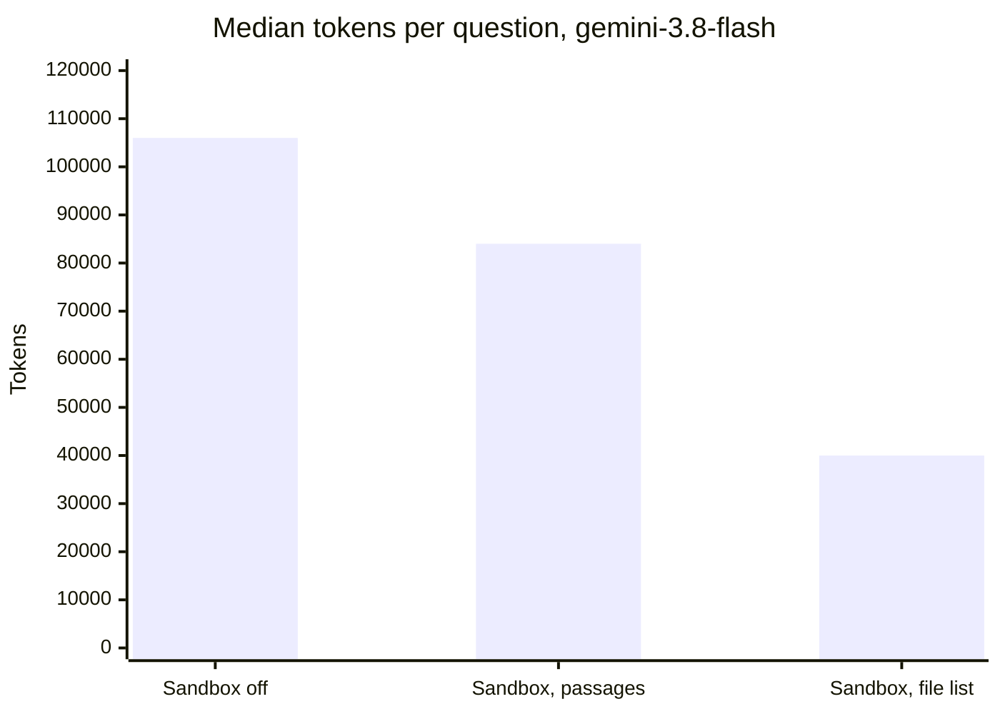
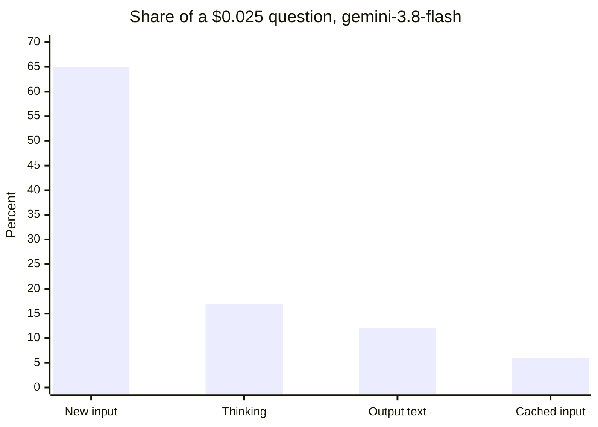
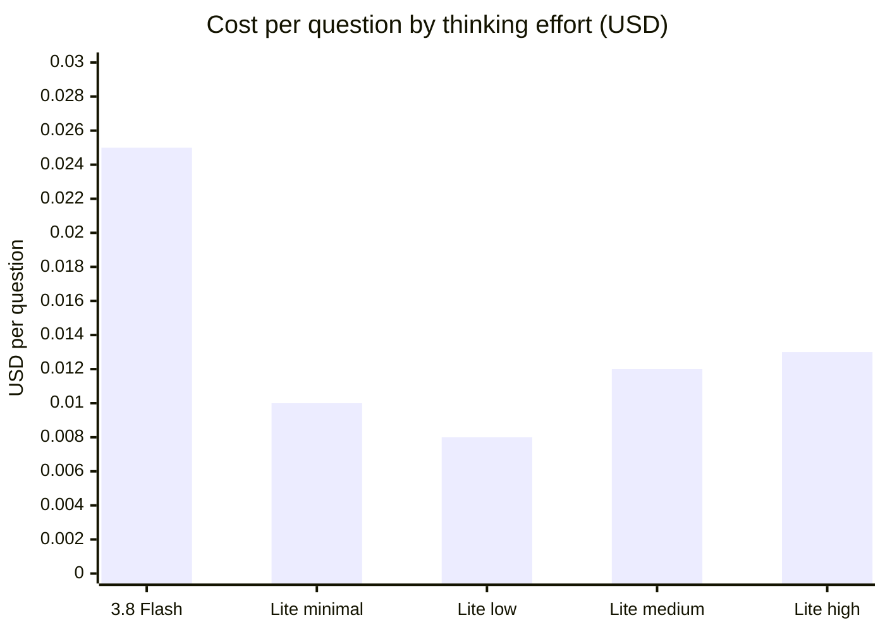
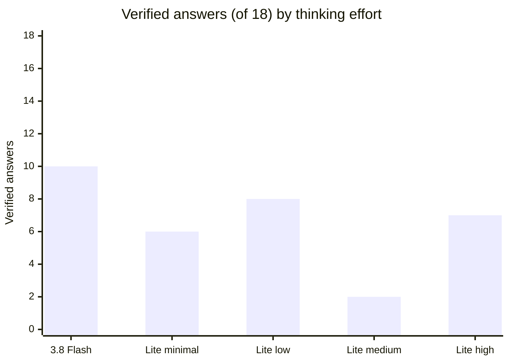
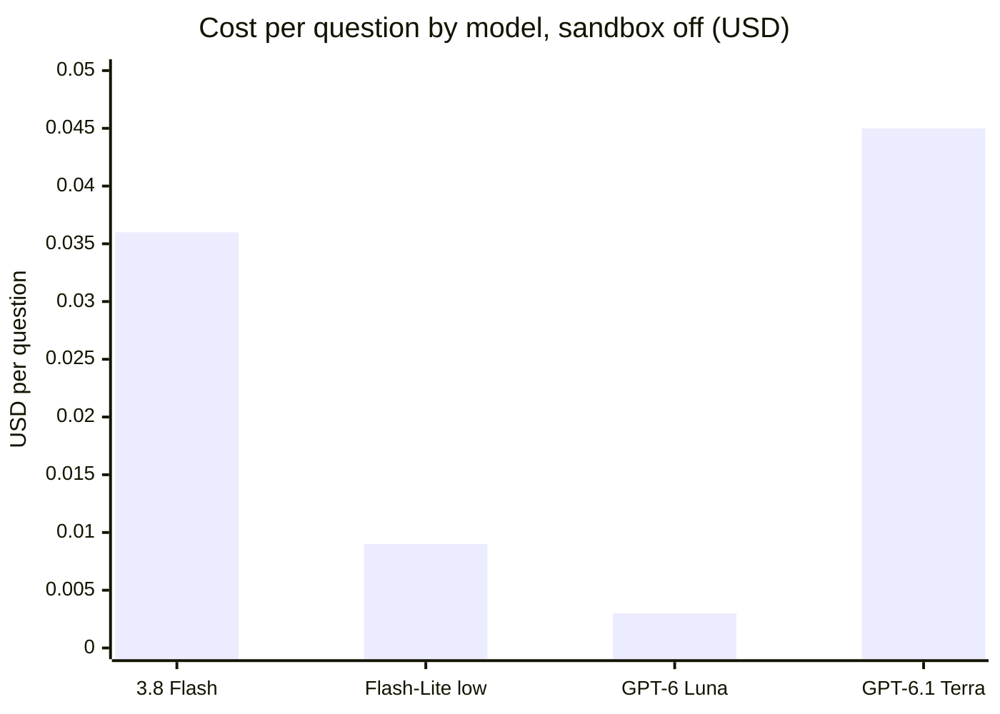
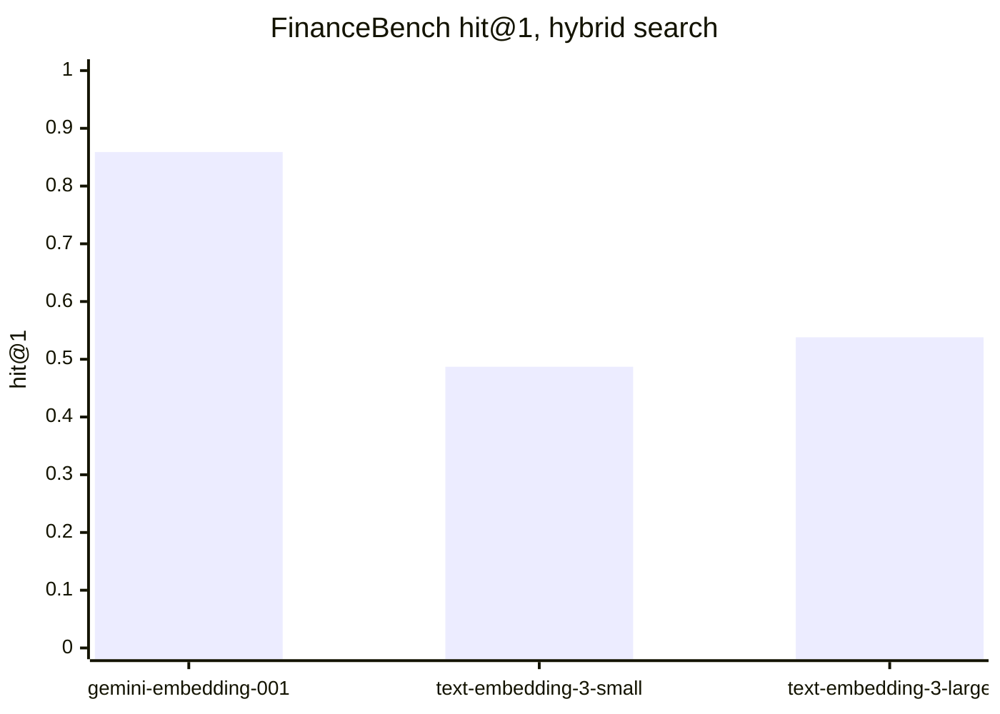
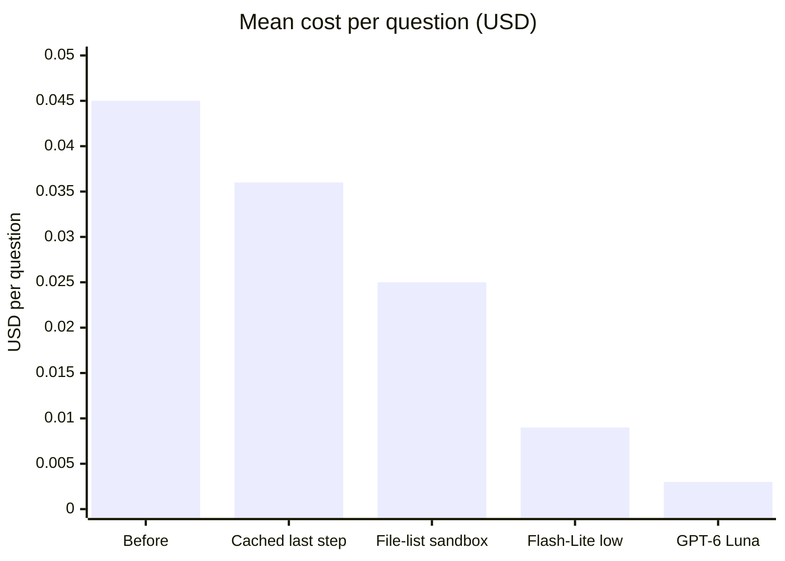

# Reducing the cost of answering questions from SharePoint documents by 93%

## Contents

- [Summary](#summary)
- [Background](#background)
- [Problem](#problem)
- [Methodology](#methodology)
  - [Instrumentation](#instrumentation)
- [Analysis and findings](#analysis-and-findings)
- [Solution](#solution)
  - [1. Reduce token cost via prompt caching](#1-reduce-token-cost-via-prompt-caching)
  - [2. Reduce total input tokens via a code interpreter](#2-reduce-total-input-tokens-via-a-code-interpreter)
  - [3. Reduce output tokens and model price via Gemini 3.5 Flash-Lite at low effort](#3-reduce-output-tokens-and-model-price-via-gemini-35-flash-lite-at-low-effort)
  - [4. Reduce model price via GPT-6 Luna](#4-reduce-model-price-via-gpt-6-luna)
  - [Not kept: reduce embedding price via OpenAI embeddings](#not-kept-reduce-embedding-price-via-openai-embeddings)
- [Results](#results)
- [How good were the answers?](#how-good-were-the-answers)
- [Lessons learned](#lessons-learned)
- [Conclusion and recommendations](#conclusion-and-recommendations)
- [References](#references)
- [Appendix: where the numbers come from](#appendix-where-the-numbers-come-from)

## Summary

We cut the cost of asking questions about documents stored in a SharePoint site by 93%, from $0.045 to $0.003 per question, for the `sharepoint_ask` tool. We pulled three levers: sending fewer input tokens to the model, getting fewer output tokens back, and paying less per token by switching to cheaper models.

We made four changes in sequence: keeping the prompt cache intact, replacing pasted search passages with a code-interpreter sandbox, moving to a cheaper Gemini model at low thinking effort, and moving to GPT-6 Luna. We also tried cheaper OpenAI embeddings and did not keep them. We measured each configuration on six questions, run three times each. After the last change the agent gave a verified answer (one whose quoted source the server checked against the file) in 9 of 18 runs, and answered 9 of 18, against 7 answered before. The sample is small. We also checked every answer from two configurations by hand against the manuals: the final configuration made no wrong claim in 18 runs, while the cheaper Gemini configuration made one in 4 of 18 (see [How good were the answers?](#how-good-were-the-answers)).

## Background

The SharePoint MCP (Model Context Protocol) server exposes an agent as a tool named `sharepoint_ask`. A caller uses it to ask a question about the documents stored in a SharePoint site. A background service watches the files in SharePoint, embeds them and tracks changes to them. This lets the tool run a hybrid search over the documents. The search returns several text chunks from different documents, and those chunks are passed to the LLM, which writes the answer.

## Problem

The tool already worked: it searched the documents and returned relevant information with references. But it cost an average of $0.045 per question, which is far too high to be a viable solution. We needed to make it an order of magnitude cheaper.

## Methodology

- **Benchmark:** We used `scripts/ask_bench.py` to ask six live questions about military vehicle manuals (the TM 9-2320-… series). Each question was run 3 times, for 18 runs per configuration, all as the same signed-in user. The agent was allowed 8 steps per question (a step is one call to the model) unless noted otherwise.
- **Cost:** LangSmith priced each `sharepoint_ask` trace from the token counts the model reported: input, cached input, output and thinking (the reasoning tokens a model produces before it answers). We averaged that price over the 18 runs. When we compared two configurations directly, we ran them within the same hour.
- **Answers:** Each run ended with a status: `answered`, `partial` or `not_found`. From change 3 onward (see [Solution](#solution)) we also counted **verified** answers: answers where the agent quoted its source and the server confirmed that the quote appeared in the file. If a model wrote its answer as plain text instead of calling `final_answer`, the run still counted as answered, but its source was never checked, so it was not verified.
- **Caveats:** 18 runs is a small sample. The same question was often answered in one run and not found in the next, so a difference of one or two answers between configurations was noise and should not be read as a real gap. Questions 1–3 ended as `partial` or `not_found` with every model and setting we tried. We first read that as a retrieval problem. Checking the library showed a different cause: it holds no Abrams manual, so the Abrams parts of questions 1 and 3 cannot be answered, and question 2 asks for a part that the M939 manuals do not name (see [How good were the answers?](#how-good-were-the-answers)).
- **Limits of the design:** We scored correctness by hand only for the final configuration (Luna) and for Flash-Lite at low effort. For every other configuration, "answered" and "verified" show only that the agent produced an answer with a checkable source, not that the answer was right. We applied the changes one after another instead of testing each in isolation, so a change's effect depends on the ones before it. We tested the OpenAI models only at medium thinking effort, while we swept Flash-Lite across every level. We did not try other orders for the changes.

The six questions:

1. HMMWV clutch roller part number, and the Abrams oil spec
2. M939 clutch roller
3. Abrams turbine inspection interval
4. M998 vs M1008 engine oil capacity (two manuals)
5. M998 tire pressure
6. M815 propeller shaft

### Instrumentation

Every `sharepoint_ask` call is one LangSmith trace, and LangSmith prices it from the model calls inside it. Embedding is now traced too, as `embed` runs that record the model and the token count:

- A search's query embedding runs inside its `sharepoint_ask` trace. The inference server joins the caller's trace using the request headers, so the trace's total cost includes the embedding.
- Indexing batches are traces of their own.
- Gemini's embed response has no token count, so a free `countTokens` call runs alongside each traced batch to get one. OpenAI's tokens are counted locally.
- No document text is sent to LangSmith, only counts. The exception is a search query's text, which is sent because the agent's trace already contains it.

## Analysis and findings

The traces showed where the money went:

- **Input was most of the bill.** Every step sent the whole conversation to the model again, and search pasted its passages into that conversation (about 6k tokens for the first result), so each later step paid for them again. In the traces we examined after change 2 (the breakdown is shown there), uncached input was still 65% of a question's cost, compared with 17% for thinking, 12% for output text and 6% for cached input.
- **The prompt cache kept breaking.** Gemini billed a cached prefix at 10% of the normal price, but rewriting earlier messages or forcing a tool choice made it read nothing from the cache. In the baseline, the forced last call alone was 37% of total spend.
- **Steps drove cost.** A question the index couldn't fully answer used every step it was given. Going from 8 to 14 steps cost 55% more for one more answer.
- **Then the price per token.** Once the tokens per question were down, the model's price was what remained. Gemini 3.8 Flash charged 7.5× Luna's input price.

## Solution

We made four changes, in the order below, plus one that we tried and did not keep. Each change pulled one or two of the three levers from the summary. We call the numbered items "changes" and reserve "step" for one call to the model. To keep the names short, we refer to `gemini-3.8-flash` as 3.8 Flash, `gemini-3.5-flash-lite` as Flash-Lite, `gpt-6-luna` as Luna and `gpt-6.1-terra` as Terra.

| Change | Input tokens | Output tokens | Model price |
|---|---|---|---|
| 1. Reduce token cost via prompt caching | ✓ fewer billed at full price | | |
| 2. Reduce total input tokens via a code interpreter | ✓ about half per question | | |
| 3. Reduce output tokens and model price via Flash-Lite | | ✓ less thinking | ✓ 60% cheaper input than 3.8 Flash |
| 4. Reduce model price via GPT-6 Luna | | | ✓ a third of Flash-Lite's input price |
| Not kept: reduce embedding price via OpenAI | | | ✓ cheaper, but retrieved far worse |

### 1. Reduce token cost via prompt caching

Gemini automatically caches the start of a conversation (the prefix) and bills cached input at 10% of the normal price. Two things in the agent kept breaking that cache, so we were paying full price for text that could have been cached:

- **Rewriting earlier messages.** An earlier version of the code interpreter (described in change 2) kept only the last 3 `run` outputs and dropped older ones. Every time an earlier message changes, the prefix changes, and nothing after that point can be read from the cache. We measured this over 14 steps: keeping every output cost **$0.061** per question, and dropping old ones cost **$0.093**. The agent now keeps every output.
- **Forcing the last answer.** On the final step the agent forced `tool_choice=final_answer` so the model had to answer. That changed the request's tool configuration, and Gemini then served none of the conversation from its cache. In the baseline bench, 12 of the 18 runs reached that final step. The forced call averaged $0.025 and made up 37% of the bench's total cost. In one trace it read none of its 19,893 prompt tokens from the cache and cost $0.0165, 44% of that run. Now the final step is sent with the usual tools plus a message saying it is the last step, which leaves the cache intact. The tool choice is forced only if the model still doesn't answer.

With the code-interpreter sandbox off, the cost fell from **$0.045 to $0.036**. That saving comes from the second fix: the baseline bench made 12 forced last calls, and the final sandbox-off bench made none. The first fix applies only to the code-interpreter variant, which the baseline did not have. We also fixed a related bug along the way: rebuilding a file's text from its chunks (`rejoin_spans`) duplicated any chunk shorter than the chunk overlap. It is fixed and tested.

### 2. Reduce total input tokens via a code interpreter

The idea (see [Code interpreter](code-interpreter.md)) was to stop pasting search passages into the conversation, because every later step paid for them again. Instead, the files the user was allowed to read would be placed in a sandbox, and the model would read only the lines it needed using shell commands such as `rg` and `sed`.

Our first version still returned passages from search, so it saved little. The version that worked returned **only where the hits were**. For each file, it gave the line range, the section and the best-matching line (at most 200 characters). The model then ran a command such as `sed -n '120,170p' S3.txt` to read just what it needed.

| `gemini-3.8-flash`, 8 steps | Sandbox off | Sandbox, passages | **Sandbox, file list** | File list, 10 steps |
|---|---|---|---|---|
| Cost per question | $0.036 | $0.036 | **$0.025** | $0.032 |
| Answered (of 18) | 8 | 10 | 8 | 9 |
| Median tokens per question | ~106k | ~84k | ~40k | ~66k |

Tokens are LangSmith's total for a trace, across every model call and including cached tokens. Each figure is the median, across the six questions, of that question's median over three runs.

- The first search result shrank from about 6k tokens to about 1.3k, and the prompt stayed under about 8k tokens until the last step.
- **The step limit is a cost lever.** We also tried raising the maximum number of steps per question while the sandbox was on. Questions the index couldn't fully answer used every step they were given, so 14 steps cost 55% more than 8 for one extra answer, and 10 steps cost 26% more for one extra answer. We kept the default at 8. The per-question numbers for the 14-step runs are in [Code interpreter](code-interpreter.md).

To see where the remaining $0.025 went, we looked at three traces:

Uncached input was about two thirds of the bill. Gemini's cache lagged 2–3 calls behind, so each call paid full price for about 2.5k tokens even though each step added only about 760 new ones. The last call (`final_answer`) alone was about 22% of the cost in those traces. We re-derived the input and output split from all 36 runs of the two file-list benches: input was 66–68% of the cost and output (including thinking) 32–34%. The finer splits above come from the three traces and were not re-derived. At this point the price per input token mattered more than any further prompt change, so it became the next lever.

### 3. Reduce output tokens and model price via Gemini 3.5 Flash-Lite at low effort

Flash-Lite costs $0.30 input, $0.03 cached input and $2.50 output per million tokens. `gemini-3.8-flash` costs $0.75 / $0.075 / $3.75, and its price doubles to $1.50 / $0.15 / $7.50 on 2027-01-01. We benched Flash-Lite at every thinking-effort level (`reasoning_effort`), using the file-list sandbox at 8 steps, with 3.8 Flash as a control:

| | 3.8 Flash | Lite minimal | **Lite low** | Lite medium | Lite high | Lite low, sandbox off |
|---|---|---|---|---|---|---|
| Cost per question | $0.025 | $0.010 | **$0.008** | $0.012 | $0.013 | $0.009 |
| Answered (of 18) | 10 | 7 | 8 | 8 | 12 | 12 |
| Verified answers (of 18) | 10 | 6 | 8 | 2 | 7 | 9 |

For scale, 3.8 Flash with the file-list sandbox at 8 steps was benched three times in this study and answered 8, 8 and 10 of 18 runs. That is the run-to-run spread to keep in mind when comparing answer counts.

**Why low:** it was the cheapest setting, and every answer it gave was verified. More thinking cost more without producing more verified answers. At medium and high, the model often wrote its answer as plain text instead of calling `final_answer`, so the server could not verify a source (at medium, 6 of 8 answers). Minimal thought less per step but needed more steps, so it ended up costing more than low.

**With a model this cheap, the sandbox stopped paying off.** Running with the sandbox off cost about the same ($0.009 against $0.008) and produced one more verified answer. The sandbox still has a use for large files and table work, but not for cost, so it is off by default (`ASK_SANDBOX=off`).

### 4. Reduce model price via GPT-6 Luna

We benched two OpenAI models against Flash-Lite at low effort, with the sandbox off and the OpenAI models at medium effort:

| Price per million tokens | Input | Cached input | Output |
|---|---|---|---|
| `gemini-3.8-flash` | $0.75 | $0.075 | $3.75 |
| `gemini-3.5-flash-lite` | $0.30 | $0.03 | $2.50 |
| **`gpt-6-luna`** | **$0.10** | **$0.01** | **$0.50** |
| `gpt-6.1-terra` | $1.00 | $0.05 | $5.00 |

| Question | Flash-Lite low | **GPT-6 Luna** | GPT-6.1 Terra |
|---|---|---|---|
| 1. HMMWV clutch roller + Abrams oil | $0.012 | $0.006 | $0.089 |
| 2. M939 clutch roller | $0.008 | $0.005 | $0.075 |
| 3. Abrams turbine interval | $0.006 | $0.004 | $0.041 |
| 4. M998 vs M1008 oil | $0.013 | $0.002 | $0.037 |
| 5. M998 tire pressure | $0.010 | $0.001 | $0.012 |
| 6. M815 propeller shaft | $0.004 | $0.001 | $0.014 |
| **Mean** | **$0.009** | **$0.003** | **$0.045** |
| Answered (of 18) | 12 | 9 | 9 |
| Verified answers (of 18) | 9 | 9 | 9 |

Flash-Lite answered more runs, but 3 of its 12 answers had no verified source, while all 9 of Luna's answers did. Reading those 3 against the manuals: one was a refusal marked "answered", one was a wrong answer (it said the M998 and M1008 oil capacities do not differ), and one was correct but cited nothing. [How good were the answers?](#how-good-were-the-answers) checks every answer from both models.

(The 3.8 Flash bar is its sandbox-off cost from change 1.)

**Why Luna:** it cost a third of what Flash-Lite did and gave the same 9 verified answers. Every answer it gave was verified, and it answered question 4 (which compared two manuals) in all three runs. A run took about 16 s (median).

**Why not Terra:** it also gave 9 verified answers, but at 14× Luna's cost. It read more on the hard questions (30–90k tokens), and its input price was 10× Luna's.

The Intelligence Index from Artificial Analysis agreed that Luna was the stronger of the two cheap models: it scored 18 at medium effort against 12 for Flash-Lite, though 3.8 Flash scored 30 at medium. On this bench, whether an answer had a verified quote mattered more than the index score.

### Not kept: reduce embedding price via OpenAI embeddings

We benched embeddings as well, since OpenAI's are cheaper: `text-embedding-3-small` costs $0.02 per million tokens and `-large` costs $0.13, against $0.15 for `gemini-embedding-001`. We added an OpenAI backend (LangChain's `OpenAIEmbeddings`) and ran it through the retrieval evals ([Evals](evals.md)), all at 1536 dimensions:

| Hybrid search (vector-only score in parentheses) | gemini-embedding-001 | 3-small | 3-large |
|---|---|---|---|
| FinanceBench hit@1 | 0.859 | 0.487 | 0.538 |
| FinanceBench wrong filing@1 (lower is better) | 0.128 | 0.487 | 0.449 |
| Multilingual hit@1 | 0.718 | 0.578 | 0.600 |
| Identifiers hit@1 | 0.999 (0.865) | 0.906 (0.253) | 0.938 (0.247) |
| Synthetic hit@1 | 0.923 | 0.923 | 0.923 |
| ACL scale hit@1 | 0.990 | 0.987 | 0.987 |

In this table, hit@1 is the share of queries whose top result is correct, and wrong filing@1 is the share whose top result comes from the wrong filing. The benchmark suites (FinanceBench, multilingual, identifiers, synthetic and ACL scale) are described in [Evals](evals.md).

**Why Gemini:** OpenAI's embeddings retrieved much worse, and the money at stake was small. Embedding a search query cost about $0.000003, and re-embedding the whole local index (46k chunks, about 10M tokens) cost about $1.50 on Gemini. Cheaper embeddings would save almost nothing and cost a lot of retrieval quality. The OpenAI backend stays available (`openai:text-embedding-3-*`) for a later comparison.

## Results

| Change | Model | Sandbox | Cost per question | vs. before | Answered (of 18) | Verified answers (of 18) |
|---|---|---|---|---|---|---|
| Before | `gemini-3.8-flash` | off | $0.045 | | 7 | not measured |
| 1. Reduce token cost via prompt caching | `gemini-3.8-flash` | off | $0.036 | −21% | 6 and 8 (two benches) | not measured |
| 2. Reduce total input tokens via a code interpreter | `gemini-3.8-flash` | on | $0.025 | −45% | 8 | not measured |
| 3. Reduce output tokens and model price via Flash-Lite | `gemini-3.5-flash-lite` | off | $0.009 | −81% | 12 | 9 |
| 4. **Reduce model price via GPT-6 Luna (the default)** | `gpt-6-luna` | off | **$0.003** | **−93%** | 9 | 9 |

| | Before | Now | Change |
|---|---|---|---|
| Cost per question | $0.045 | $0.003 | −93% |
| Questions per $1 | ~22 | ~320 | 14× |
| Verified answers (of 18) | not measured (7 answered) | 9 | |
| Default model | `gemini-3.8-flash` | `gpt-6-luna`, medium effort | |
| Embedding model | `gemini-embedding-001` | unchanged | |
| Sandbox | none | built, off by default | |

## How good were the answers?

The sections above count answers. This one checks whether they were right.

### Source of truth

The library is the "Documentos" library of the `intranet` site. It holds 52 files: 50 PDFs (wheeled-vehicle and trailer manuals) and 2 Word files (`Demo.docx`, `Test.docx`). The other four sites' libraries are empty. None of the files covers the Abrams M1A2 or its AGT1500 turbine. Searches for "Abrams", "M1A2", "AGT1500" and "TM 9-2350" return only wheeled-vehicle manuals. The manuals the six questions need are `TM 9-2320-280` (HMMWV), `-289` (CUCV, which includes the M1008), `-272` (M939) and `-260` (M815).

We read each fact from the manual text that the index holds for the page (`sharepoint_search`) and from the quotes the server verified against the files in the traces. This is what the manuals say:

| Question | What the library says | Source |
|---|---|---|
| 1. HMMWV clutch roller and Abrams oil | HMMWV: "ROLLER ASSEMBLY,CLU", part number **930679**, NSN 2520-01-149-1221. A second variant for a different vehicle-code set has part number **7471009**, NSN 3110-01-480-5240. Abrams: **not in the library.** | TM 9-2320-280-24P-1, Fig. 106 item 2 (PDF p. 401) and Fig. 107 item 2 (p. 407) |
| 2. M939 clutch roller | No item is named "clutch roller". The nearest are in the fan clutch: "SCREW,ROLLER ASSEMB", part number **13222E0109**, NSN 5305-01-210-4595, and a ball bearing, part number 6017-2RS, NSN 3110-01-126-1287. | TM 9-2320-272-24P-1, Fig. 120 (pp. 366–367) |
| 3. Abrams turbine interval | **Not in the library.** | none |
| 4. M998 vs M1008 oil | M998: 8 qt (7.6 L) with filter. M1008 CUCV: 7 qt with filter. The M998 holds **1 qt** more. | TM 9-2320-280-10, pp. 42 and 392; TM 9-2320-289-20, p. 56 |
| 5. M998 tire pressure | At GVW: bias tires 20 front / 22 rear psi, radial tires 20 / 25 psi. Unloaded: bias 16 / 18, radial 15 / 18. Mud, sand and snow: bias 12 / 16, radial 12 / 20. | TM 9-2320-280-10 Change 3, pp. 145–146 |
| 6. M815 propeller shaft | Paragraph 13-14: three removal steps, three installation steps, and a follow-on task to reinstall the drivechain and sprockets. | TM 9-2320-260-20, PDF pp. 1007–1008 |

So the library can fully answer questions 4, 5 and 6. It can answer half of question 1, and it can only point to nearby parts for question 2. Question 3 and the Abrams half of question 1 cannot be answered from it, and the correct reply to those is "not found".

### Method

We graded every answer from the 18 runs of the final configuration (`luna-medium3`) and the 18 runs of Flash-Lite at low effort with the sandbox off (`lite-low-nosandbox`), using the full answer text stored in the LangSmith traces. We also ran the six questions once through the deployed `sharepoint_ask` tool. Each answer was graded **correct**, **correct but incomplete**, **acceptable hedge** (it gave the nearest real parts and said the exact item is not named), **correct refusal**, or **wrong** (it made a claim the manuals contradict). One grader (an AI model, not a person) did this against the index text of the manual pages, not the page images.

### Grades by question

| Question | GPT-6 Luna (the default), 3 runs | Flash-Lite low, 3 runs |
|---|---|---|
| 1. HMMWV roller and Abrams oil | 3 × `partial`. Gave 930679 and said the Abrams capacity could not be found. **Correct but incomplete**: it did not mention the 7471009 variant. | 3 × `partial`, all **wrong**. Reported 28 qt (with filter) and 26 qt (without) as the "Abrams turbine oil capacity", taken from TM 9-2320-360-10, which is the manual for the M1070 truck tractor. It also said no HMMWV clutch roller part number exists. |
| 2. M939 clutch roller | 3 × `partial`. Gave 13222E0109 in two runs and the 6017-2RS bearing in one, and said none is named "clutch roller". **Acceptable hedge.** | 2 × `answered`, 1 × `partial`. All gave 13222E0109. **Acceptable.** |
| 3. Abrams interval | 3 × `not_found`. **Correct refusal.** | 3 correct refusals. One was marked `answered` and ended with a sentence in Japanese. |
| 4. M998 vs M1008 oil | 3 × `answered`: 1 qt. **Correct.** | 2 correct. 1 **wrong**: "do not differ", with no sources. |
| 5. M998 tire pressure | 3 × `answered`. **Correct**, including the bias and radial split. | 3 correct. One cited no source. |
| 6. M815 propeller shaft | 3 × `answered`. **Correct**: every step matches the manual. | 3 correct. |
| **Wrong answers** | **0 of 18** | **4 of 18** |

The live run of the deployed tool gave the same results as the Luna bench: `partial`, `partial`, `not_found`, `answered`, `answered`, `answered`, with no wrong claim.

### What this shows

- **The final configuration answered every question it could.** It answered questions 4, 5 and 6 in all 9 runs, each with a verified quote, and its other 9 runs were refusals or hedges on questions the library cannot fully answer. No answer contained a claim the manuals contradict.
- **Questions 1–3 were never a retrieval failure.** The earlier reading, that they stayed `partial` or `not_found` because search missed the files, was wrong for the Abrams parts: there is nothing to find. So differences in answered counts between models mostly reflect how they label hedges and refusals on questions 1–3, not how well they retrieve.
- **A higher answered count hid the weaker model.** Flash-Lite answered 12 runs to Luna's 9, and made 4 wrong claims to Luna's none. Three of its 12 answers had no verified source: a refusal with the wrong label, a wrong answer, and a correct answer without a source.
- **Verification caught one of the two kinds of error.** The wrong "do not differ" answer had no verified source, so the verified count excluded it. The wrong Abrams answer did carry a real quote, from another vehicle's manual, so it passed the check. A verified quote shows that the text exists in the file, not that it is about the right vehicle.
- **One gap remains in the final configuration.** For question 1 it gave one of two part numbers, without saying that the other applies to a different vehicle-code set. A caller who asks about a specific variant could get the wrong number.

### Limits

One grader, graded against index text. Only two configurations were graded by hand, so the answered and verified counts for 3.8 Flash, the sandbox variants and Terra remain unchecked for correctness. Eighteen runs on six questions cannot support a rate: "0 of 18 wrong" says that no error showed up, not that errors are rare.

## Lessons learned

The order we worked in mattered here, though we did not test other orders. Caching and the file-list search cut the number of tokens. Once the token count was low, the price per token was what remained, and cheaper models cut that. With the cheapest model, the sandbox no longer saved enough to stay on.

- **Keep the prompt cache warm before anything else.** Two small changes (leaving old messages unchanged and not forcing the last call) cut cost by 21% without touching the model.
- **Keep document text out of the conversation.** Returning where the hits are, rather than what they say, halved the tokens per question.
- **Measure verified answers, not just answers, and then check them against the source.** A model that wrote its answer as plain text looked as good as any other in the status counts, but its source was never checked. Flash-Lite at medium effort did this in 6 of its 8 answers. Verification has a limit too: Flash-Lite at low effort quoted a real line from the wrong vehicle's manual and reported it as the Abrams oil capacity. The quote verified, and the answer was still wrong.
- **A benchmark score doesn't pick the model.** Luna scored well below Gemini 3.8 Flash on Artificial Analysis (18 against 30), yet here it gave 9 verified answers against 10, at an eighth of the cost. With 18 runs, that gap of one answer is within the noise.
- **Cheaper isn't always worth it.** OpenAI's embeddings would have saved under $1.50 per re-index, and cut FinanceBench hit@1 from 0.86 to 0.54 or lower.

## Conclusion and recommendations

`sharepoint_ask` now costs $0.003 per question. It uses GPT-6 Luna at medium effort, the sandbox off and Gemini embeddings, and it answered 9 of 18 runs, against 7 before. That difference is within the noise. Checked by hand against the manuals, none of Luna's 18 answers contained a wrong claim, and the 9 runs it did not answer are on questions the library cannot fully answer. The next steps are:

- **Fix the benchmark before fixing retrieval.** Questions 1 and 3 ask about the Abrams, which is not in the library, and question 2 asks for a part that the M939 manuals do not name. Replace them with questions the library can answer, record the correct answer and source page for each, and score every run against them. In the traces, the agent also spent 6–8 steps on questions 2 and 3 working out which manual covers which vehicle, because manual titles are TM numbers. Listing the vehicles each manual covers is still worth trying.
- **Rerun the agent evals with Luna.** The baselines in [Evals](evals.md) were measured with `gemini-3.8-flash`.
- **Score answers for correctness.** Check each answer against the manual, so that quality is measured and not inferred from answer status.
- **Add more questions.** A bench of 6 questions can't separate models whose answer counts differ by one or two.

## References

- [Code interpreter](code-interpreter.md): the sandbox design and every bench table, per question.
- [Architecture](architecture.md): the agent, the inference-server and the embedding decision.
- [Evals](evals.md): the retrieval and agent eval suites.
- `scripts/ask_bench.py`: the bench (`--label`, `--model`, `--model-kwargs`, `--no-sandbox`, `--max-steps`); results are LangSmith traces tagged with the bench label.
- Prices: [Gemini API pricing](https://ai.google.dev/gemini-api/docs/pricing), [OpenAI text-embedding-3-small](https://developers.openai.com/api/docs/models/text-embedding-3-small), [text-embedding-3-large](https://developers.openai.com/api/docs/models/text-embedding-3-large), [GPT-6.1 Terra](https://pricepertoken.com/pricing-page/model/openai-gpt-6.1-terra).
- [Artificial Analysis](https://artificialanalysis.ai): Intelligence Index scores.

## Appendix: where the numbers come from

Every cost in this study comes from LangSmith, project `normabot-local`. Each bench run is a `sharepoint_ask` trace tagged with `bench=<label>`. We re-derived each cost as the label's total trace cost divided by its 18 runs.

| Configuration | Bench label | Mean cost per question | Reported |
|---|---|---|---|
| Before | `before-1` | $0.0455 | $0.045 (was $0.046 in earlier drafts) |
| Keep 3 `run` outputs, 14 steps | `after-keep3` | $0.0934 | $0.093 |
| Keep every output, 14 steps | `after-keepall` | $0.0608 | $0.061 |
| Final code, sandbox off | `final3-off` | $0.0360 | $0.036 |
| Final code, sandbox on with passages, 8 steps | `final3-sb8` | $0.0357 | $0.036 |
| Final code, sandbox on, 14 steps | `final3-sb14` | $0.0555 | $0.056 |
| Sandbox off, file-list control | `filelist-off` | $0.0355 | $0.036 |
| File list, 8 steps | `filelist-sb8`, `filelist-sb8b` | $0.0238, $0.0263 | $0.025 (mean of the two) |
| File list, 10 steps | `filelist-sb10` | $0.0315 | $0.032 |
| 3.8 Flash control | `flash38-ctrl` | $0.0247 | $0.025 |
| Flash-Lite minimal, low, medium, high | `lite-minimal`, `lite-low`, `lite-medium`, `lite-high` | $0.0097, $0.0083, $0.0118, $0.0134 | $0.010, $0.008, $0.012, $0.013 |
| Flash-Lite low, sandbox off | `lite-low-nosandbox` | $0.0086 | $0.009 |
| GPT-6 Luna, medium | `luna-medium3` | $0.0032 | $0.003 |
| GPT-6.1 Terra, medium | `terra-medium3` | $0.0446 | $0.045 |

What the re-derivation changed and confirmed:

- **Changed:** the baseline is $0.0455, not $0.046. The first saving is −21%, not −22%, and the 14-step overhead is +55%, not +56%. Questions per $1 for Luna are ~320, not ~310. The −45%, −81% and −93% figures hold. The median-token row in change 2 was wrong for three of four columns and is replaced (the LangSmith values are 106k, 84k, 40k and 66k tokens).
- **Confirmed:** the output prices in the price table. Dividing each label's completion cost by its completion tokens gives exactly $3.75, $2.50, $0.50 and $5.00 per million for 3.8 Flash, Flash-Lite, Luna and Terra. We could not isolate the input prices, because the cached share is not in the aggregate. Luna's median latency is 16.3 s and Terra's 14.7 s, matching the 16 and 15 s reported. Luna's statuses re-derive exactly: 9 `answered`, 6 `partial`, 3 `not_found`.
- **Not re-derived:** the answered counts for configurations other than Luna and Flash-Lite low (sandbox off), which come from the bench script's own output. The 22% last-call share in change 2 and the split of that bill into thinking, text, new and cached input come from three traces. The Luna and Terra input prices and the 2027-01-01 price change have no source in the references.
- **Left out:** benches that recorded no usable cost because they stopped before a model call or were rate-limited (`final-off`, `final-sb8`, `final-sb14`, `luna-medium`, `luna-medium2`, `terra-medium`, `terra-medium2`) and the single-run smoke tests.
