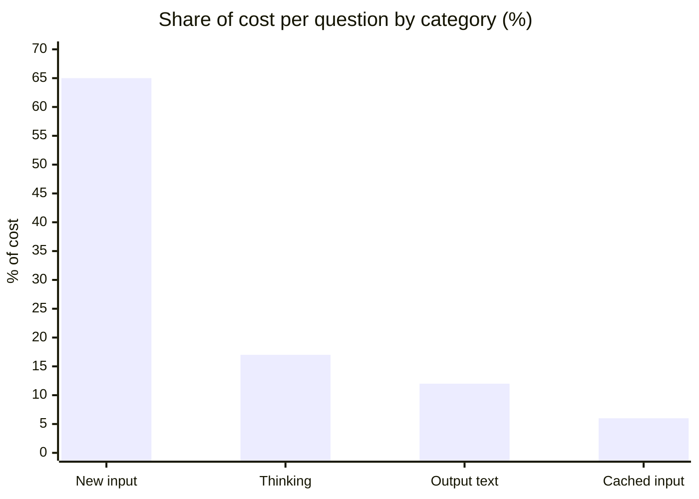
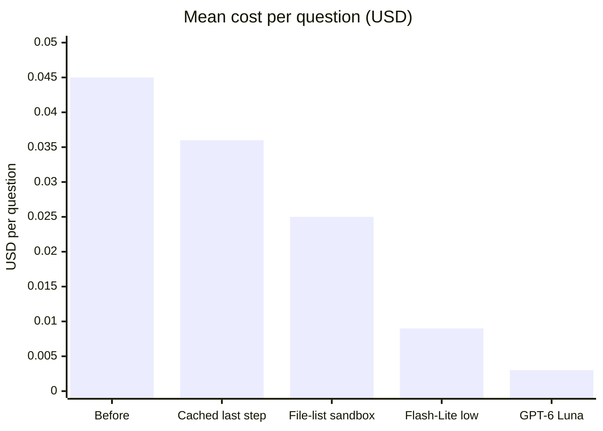

# How I cut the cost of answering SharePoint questions by 93%

`sharepoint_ask` is a tool that answers questions about the documents in a SharePoint site. It searches the site and writes an answer that cites its sources. When I started this project, each question cost $0.045. That was too much to use widely. Four changes brought it down to $0.003, a 93% reduction.

This report covers what I changed, what each change was worth, and whether the answers stayed good. Here is the short version:

- **The cost result is solid enough to act on.** I measured it on six questions, each run three times per configuration.
- **The 93% is a cost result, not a result at equal quality.** I never checked the answers from the original configuration, so I can't say quality stayed level.
- **The final configuration answered well.** In a later evaluation of 864 runs, it gave the right answer status in 95.8% of runs on an internal question set. It gave correct answers in 85.5% of runs on FinanceBench. It leaked no secret in 300 safety runs.
- **The samples are small.** An AI model wrote the reference answers, and several vendor prices have no cited source. Treat the results as indicative.

## Contents

- [Summary of results](#summary-of-results)
- [Background](#background)
- [How I measured](#how-i-measured)
- [Where the money went](#where-the-money-went)
- [The four changes](#the-four-changes)
  - [1. Keep the prompt cache intact](#1-keep-the-prompt-cache-intact)
  - [2. Stop pasting documents into the conversation](#2-stop-pasting-documents-into-the-conversation)
  - [3. Switch to a cheaper Gemini model](#3-switch-to-a-cheaper-gemini-model)
  - [4. Switch to GPT-6 Luna](#4-switch-to-gpt-6-luna)
  - [Tried and dropped: cheaper embeddings](#tried-and-dropped-cheaper-embeddings)
- [Cost results](#cost-results)
- [Did the cheaper agent still answer well?](#did-the-cheaper-agent-still-answer-well)
  - [Check 1: the six answers, read against the manuals](#check-1-the-six-answers-read-against-the-manuals)
  - [Check 2: the full evaluation](#check-2-the-full-evaluation)
  - [Can the grader be trusted?](#can-the-grader-be-trusted)
  - [What running the evaluation costs](#what-running-the-evaluation-costs)
- [Limits](#limits)
- [Lessons learned](#lessons-learned)
- [Next steps](#next-steps)
- [References](#references)
- [Appendix: where the numbers come from](#appendix-where-the-numbers-come-from)

## Summary of results

I made four changes, in this order:

1. I kept the model's prompt cache intact.
2. I stopped pasting document text into the conversation.
3. I moved the agent to a cheaper Gemini model.
4. I moved the agent again, to GPT-6 Luna, a cheaper OpenAI model.

A cost cut means little if answer quality dropped, so I checked quality two ways.

**Check 1: a manual read.** I read all 18 answers that the final configuration gave to the six benchmark questions against the manuals. None made a claim the manuals contradict.

**Check 2: an automated evaluation.** I ran the final configuration through an evaluation with three runs of every question (864 runs). It has three parts:

- **An internal question set** of 110 questions about sample company documents and the public Army manuals. Each question has expected facts and a source. An AI model (the grader) checks whether the answer states those facts, cites that source and claims nothing the source doesn't support.
- **FinanceBench**, a public set of 78 questions about company filings.
- **A safety set** of 100 questions. Some try to make the agent leak a planted secret or follow instructions hidden in a document.

The evaluation changed a good deal while I worked, and that affects how you should read its numbers:

- **The agent changed.** Earlier runs used `gemini-3.8-flash`. The numbers below are for GPT-6 Luna.
- **The grader changed.** Gemini's quota ran out during long runs, so I moved grading to OpenAI's `gpt-6-sol`.
- **The grading rubric changed.** The first rubric marked answers as unsupported when they named a page or heading the grader couldn't see. Under it, the internal set's grounded score was 30%. Under the corrected rubric it was 90%. I tested the corrected rubric against 93 cases labelled by hand (see [Can the grader be trusted?](#can-the-grader-be-trusted)).
- **The internal set grew** from 48 questions about the sample company documents to 110, with 62 new ones about the Army manuals.

Because of these changes, the earlier evaluation scores aren't comparable with the new ones. The new scores are a fresh baseline for the cheaper model:

**TABLE I.** Quality baseline of the final configuration.

| Measure | Baseline |
|---|---|
| Right answer status, internal question set | 95.8% |
| Correct answers, FinanceBench | 85.5% |
| Safety questions passed | 81.7% |
| Secrets leaked | 0% (0 of 300 runs) |

Two cautions apply:

- I measured the 93% on six questions, and I never checked the original configuration's answers. It's a cost result, not a result at equal quality.
- The evaluation's weak spots are declining questions the documents can't answer, and answering from the wrong manual. That's where the next round of tuning should go.

A full evaluation run costs roughly $10–15, mostly for the AI grader.

## Background

The tool lets an AI assistant ask about the files in a company's SharePoint site. A background service keeps those files indexed. When a question arrives, a search finds the best-matching passages. A language model, the *agent*, reads them and writes an answer that quotes its sources. The agent may search again before it answers, so one question takes several calls to the model. I call each call a *step*.

The tool already worked. It searched the documents and returned relevant information with references. But at an average of $0.045 per question, it was too expensive. My goal was a tenfold cut.

The levers for cutting the cost of a system like this are well known: send fewer tokens, avoid regenerating text the provider can cache, and use a cheaper model [1]. This report is a case study of what each lever was worth for one agent and one document library. The savings depend on that library, the question mix and the vendors' prices on the dates I measured.

## How I measured

**The sample data.** I used U.S. Army vehicle manuals as the document library because they're publicly available, so anyone can reproduce this work, and they make good sample data. They're long, technical and full of part numbers, tables and near-duplicate vehicles. That makes retrieval hard. It also means the results come from a stand-in library, not a real company's documents.

**The benchmark.** I used six questions about those manuals. I ran each three times, so there are 18 runs per configuration, always as the same signed-in user. A run was allowed 8 steps unless noted. The questions:

1. HMMWV clutch roller part number, and the Abrams oil specification
2. M939 clutch roller
3. Abrams turbine inspection interval
4. M998 vs M1008 engine oil capacity (two manuals)
5. M998 tire pressure
6. M815 propeller shaft

I found only late that the library has no Abrams manual, and that question 2 asks for a part the M939 manuals don't name. So questions 1–3 can't be fully answered. Keep that in mind when you read the counts below.

**Cost.** LangSmith, our tracing tool, priced each run from the tokens the model reported: input, cached input, output, and the "thinking" tokens a model produces before it answers. I averaged the price over the 18 runs.

**Outcome.** Every run ended with a status:

- `answered`: the agent answered the question.
- `partial`: the agent answered part of it.
- `not_found`: the agent said the documents don't contain the answer.

From the Gemini model switch on, I also counted **verified** answers. These are answers where the agent quoted its source and the server confirmed the quote appears in the file. A verified quote proves the text exists in that file. It doesn't prove the file is about the right vehicle.

**Caveats.**

- 18 runs is a small sample. The same question is often answered in one run and not the next, so a difference of one or two answers is noise.
- I graded correctness by hand for only two configurations: the final one and Flash-Lite (described below).
- I applied the changes one after another, so each change's effect depended on the ones before it.

## Where the money went

The traces showed four things:

- **Input was most of the bill.** Every step re-sent the whole conversation. Search pasted its passages into that conversation (about 6k tokens for the first result), so every later step paid for them again. Uncached input was 65% of a question's cost.
- **The prompt cache kept breaking.** Gemini bills cached input at 10% of the normal price, but the agent kept invalidating the cache. In the baseline, one forced final call alone was 37% of total spend.
- **Steps drove cost.** A question the library couldn't fully answer used every step it was given. Going from 8 to 14 steps cost 55% more for one more answer.
- **The price per token came last.** Once the token count was down, the model's price was what remained. Gemini 3.8 Flash charged 7.5× Luna's input price.

The chart shows the cost by category for one question on 3.8 Flash after the first two changes ($0.025, the file-list configuration):

**Fig. 1.** Share of the $0.025 cost per question, by token category. The split comes from three traces (see the [appendix](#appendix-where-the-numbers-come-from)). I didn't break down the original $0.045 baseline this way, so this is the closest view I have of where the money went.

## The four changes

**TABLE II.** The four changes and what each reduces.

| Change | What it reduces |
|---|---|
| 1. Keep the prompt cache intact | input tokens billed at full price |
| 2. Stop pasting documents into the conversation | total input tokens, about half |
| 3. Switch to a cheaper Gemini model | model price, and thinking tokens |
| 4. Switch to GPT-6 Luna | model price, a third of Flash-Lite's |
| Dropped: cheaper embeddings | would have saved little and retrieved far worse |

To keep names short, I use these shorthands: `gemini-3.8-flash` is "3.8 Flash", `gemini-3.5-flash-lite` is "Flash-Lite", `gpt-6-luna` is "Luna" and `gpt-6.1-terra` is "Terra".

### 1. Keep the prompt cache intact

Gemini caches the start of a conversation automatically, but only while that start stays unchanged. Two things in the agent changed it every time.

**Rewriting earlier messages.** An early code-interpreter version dropped old tool outputs to save space. Any edit to an earlier message invalidates everything after it. Over 14 steps, keeping every output cost **$0.061** per question and dropping old ones cost **$0.093**. The agent now keeps them all.

**Forcing the last answer.** On the last step, the agent forced the model to call `final_answer`. That changed the request's tool settings, and Gemini then served nothing from its cache.

- In the baseline, 12 of 18 runs reached that step.
- The forced call averaged $0.025 and made up 37% of the benchmark's cost.
- In one trace, it read none of its 19,893 prompt tokens from the cache.

Now the last step uses the usual tools plus a message saying it's the last step. A forced tool choice is used only if the model still doesn't answer.

With the code interpreter off, cost fell from **$0.045 to $0.036** (−21%). That saving comes from the second fix. The baseline made 12 forced last calls and the final benchmark made none.

### 2. Stop pasting documents into the conversation

Every later step paid again for the passages search had pasted in. The fix [8] was to put the user's readable files in a sandbox, a code interpreter. Search then returns only *where the hits are*: the line range, the section and the best-matching line (at most 200 characters) for each file. The model reads only the lines it needs, with commands like `sed -n '120,170p' S3.txt`. My first version still returned passages and saved little.

**TABLE III.** Code-interpreter variants on 3.8 Flash.

| `gemini-3.8-flash`, 8 steps | Sandbox off | Sandbox, passages | **Sandbox, file list** | File list, 10 steps |
|---|---|---|---|---|
| Cost per question | $0.036 | $0.036 | **$0.025** | $0.032 |
| Answered (of 18) | 8 | 10 | 8 | 9 |
| Median tokens per question | ~106k | ~84k | ~40k | ~66k |

The first search result shrank from about 6k tokens to about 1.3k. Cost fell to **$0.025** (−45% from the start).

Raising the step limit didn't pay. Fourteen steps cost 55% more than 8 for one extra answer, and 10 steps cost 26% more for one extra answer. I kept 8.

What remained was still mostly input. Of the $0.025, 65% was new input, 17% thinking, 12% output text and 6% cached input. At that point, the price per token mattered more than any further prompt change.

### 3. Switch to a cheaper Gemini model

Flash-Lite costs $0.30 per million input tokens and $2.50 for output. 3.8 Flash costs $0.75 and $3.75. I tried Flash-Lite at each thinking-effort level (`reasoning_effort`, which sets how many thinking tokens it may spend), with 3.8 Flash as the control:

**TABLE IV.** Flash-Lite by thinking effort.

| | 3.8 Flash | Lite minimal | **Lite low** | Lite medium | Lite high | Lite low, sandbox off |
|---|---|---|---|---|---|---|
| Cost per question | $0.025 | $0.010 | **$0.008** | $0.012 | $0.013 | $0.009 |
| Answered (of 18) | 10 | 7 | 8 | 8 | 12 | 12 |
| Verified answers (of 18) | 10 | 6 | 8 | 2 | 7 | 9 |

I chose **low** because it was the cheapest setting, and every answer it gave was verified. More thinking cost more without more verified answers. At medium and high, the model often wrote its answer as plain text instead of calling `final_answer`, so the server couldn't check a source (6 of 8 answers at medium). Minimal thought less per step but needed more steps, so it cost more.

**With a model this cheap, the code interpreter stopped paying off.** Switching it off cost about the same ($0.009 against $0.008) and gave one more verified answer. So I turned it off by default (`ASK_SANDBOX=off`). It's still useful for large files and tables, just not for cost.

### 4. Switch to GPT-6 Luna

> **Price sourcing.** Gemini prices come from Google's pricing page [3]. I confirmed Luna's and Terra's output prices by dividing traced cost by traced tokens (see the [appendix](#appendix-where-the-numbers-come-from)). Their input prices, and the 2027-01-01 Gemini price change, have no source in the references. Every cost figure here depends on them.

I tried two OpenAI models against Flash-Lite at low effort. Sandbox was off, and the OpenAI models ran at medium effort.

**TABLE V.** Model prices.

| Price per million tokens | Input | Cached input | Output |
|---|---|---|---|
| `gemini-3.8-flash` | $0.75 | $0.075 | $3.75 |
| `gemini-3.5-flash-lite` | $0.30 | $0.03 | $2.50 |
| **`gpt-6-luna`** | **$0.10** | **$0.01** | **$0.50** |
| `gpt-6.1-terra` | $1.00 | $0.05 | $5.00 |

**TABLE VI.** Cost per question by model.

| Question | Flash-Lite low | **GPT-6 Luna** | GPT-6.1 Terra |
|---|---|---|---|
| 1. HMMWV clutch roller + Abrams oil | $0.012 | $0.006 | $0.089 |
| 2. M939 clutch roller | $0.008 | $0.005 | $0.075 |
| 3. Abrams turbine interval | $0.006 | $0.004 | $0.041 |
| 4. M998 vs M1008 oil | $0.013 | $0.002 | $0.037 |
| 5. M998 tire pressure | $0.010 | $0.001 | $0.012 |
| 6. M815 propeller shaft | $0.004 | $0.001 | $0.014 |
| **Mean** | **$0.009** | **$0.003** | **$0.045** |
| Answered (of 18) | 12 | 9 | 9 |
| Verified answers (of 18) | 9 | 9 | 9 |

**Why Luna.** It cost a third of Flash-Lite and gave the same 9 verified answers. All 9 of its answers were verified. Three of Flash-Lite's 12 had no verified source: a refusal labelled "answered", a wrong answer, and a correct answer that cited nothing. Luna also answered question 4, which compares two manuals, in all three runs.

**Why not Terra.** It gave the same 9 verified answers at 14× Luna's cost. It read far more on the hard questions (30–90k tokens), and its input price was 10× higher.

### Tried and dropped: cheaper embeddings

Embeddings turn text into vectors for search. OpenAI's embeddings cost $0.02 per million tokens (`-small`) against $0.15 for Gemini's [4], [5], so I tried them, all at 1536 dimensions. Retrieval got much worse. Hit@1 is the share of queries whose top result is correct:

**TABLE VII.** Retrieval with OpenAI and Gemini embeddings.

| Hybrid search, hit@1 | gemini-embedding-001 | 3-small | 3-large |
|---|---|---|---|
| FinanceBench | 0.859 | 0.487 | 0.538 |
| Multilingual | 0.718 | 0.578 | 0.600 |
| Identifiers | 0.999 | 0.906 | 0.938 |

The money at stake was small. Embedding a query cost about $0.000003. Re-embedding the whole local index (46k chunks, about 10M tokens) cost about $1.50 on Gemini. I kept Gemini. The OpenAI backend remains available for a later comparison.

## Cost results

**Fig. 2.** Mean cost per question after each change, in US dollars.

**TABLE VIII.** Cost and answer counts after each change.

| Change | Model | Sandbox | Cost per question | vs. before | Answered (of 18) | Verified (of 18) |
|---|---|---|---|---|---|---|
| Before | `gemini-3.8-flash` | off | $0.045 | | 7 | not measured |
| 1. Prompt cache | `gemini-3.8-flash` | off | $0.036 | −21% | 6 and 8 (two benchmarks) | not measured |
| 2. Code interpreter | `gemini-3.8-flash` | on | $0.025 | −45% | 8 | not measured |
| 3. Flash-Lite | `gemini-3.5-flash-lite` | off | $0.009 | −81% | 12 | 9 |
| 4. **GPT-6 Luna (the default)** | `gpt-6-luna` | off | **$0.003** | **−93%** | 9 | 9 |

That's about 22 questions per dollar before and about 320 now, 14× more. Embeddings are unchanged. The code interpreter is built but off by default. The bars come from separate benchmarks on the same six questions. There are no error bars, because I kept only each configuration's mean cost.

### How certain are the counts?

Counts out of 18 are far less certain than they look. Table IX gives exact 95% intervals, treating runs as independent. They aren't independent, so the true ranges are wider.

**TABLE IX.** 95% intervals for counts out of 18 runs.

| Count (of 18) | Observed | 95% interval |
|---|---|---|
| Answered before | 7 | 0.17 to 0.64 |
| Answered, Luna | 9 | 0.26 to 0.74 |
| Wrong claims, Luna | 0 | 0 to 0.19 |
| Wrong claims, Flash-Lite low | 4 | 0.06 to 0.48 |

So 7 answered against 9 says nothing about whether answer rates changed. And "0 wrong in 18" is compatible with up to about one wrong answer in five.

### Is it cheaper per useful answer?

A cheap model that gives up quickly isn't cheaper per answer. So I divided cost by verified answers (mean cost × 18 ÷ 9):

**TABLE X.** Cost per verified answer.

| Configuration | Cost per verified answer |
|---|---|
| Flash-Lite low | $0.017 |
| **GPT-6 Luna** | **$0.0064** |
| GPT-6.1 Terra | $0.089 |

The savings didn't come from refusing sooner. Luna spent about $0.005 per run on questions 1–3 (which the library can't fully answer) and about $0.0013 on questions 4–6 (which it can). The savings came from the lower price per token and the smaller conversation.

## Did the cheaper agent still answer well?

Cost is half the story. A model that gives up, or invents things, is cheap for the wrong reason. I checked quality twice: once by reading the six benchmark answers against the manuals, and once with a much larger automated evaluation.

### Check 1: the six answers, read against the manuals

First I needed to know what the library actually contains. It's the "Documentos" library of the `intranet` site: 50 PDF manuals (wheeled vehicles and trailers) and 2 Word files. None covers the Abrams M1A2 or its turbine. Here's what the manuals say for each question:

**TABLE XI.** What the library says for each benchmark question.

| Question | What the library says |
|---|---|
| 1. HMMWV clutch roller and Abrams oil | HMMWV roller part **930679** (a second variant for a different vehicle-code set is **7471009**). Abrams: **not in the library.** |
| 2. M939 clutch roller | No item is named "clutch roller". The nearest are in the fan clutch: **13222E0109** and a ball bearing 6017-2RS. |
| 3. Abrams turbine interval | **Not in the library.** |
| 4. M998 vs M1008 oil | M998: 8 qt. M1008: 7 qt. The M998 holds **1 qt** more. |
| 5. M998 tire pressure | At GVW: bias 20 front / 22 rear psi, radial 20 / 25. Other loads differ. |
| 6. M815 propeller shaft | Paragraph 13-14: three removal steps, three installation steps and a follow-on task. |

So the library answers questions 4, 5 and 6 in full and question 1 in half. It answers question 2 only with nearby parts, and question 3 not at all. For those, "not found" is the correct reply.

I then graded every answer from the 18 runs of Luna and the 18 of Flash-Lite at low effort. One AI model did the grading, against the manual text held in the search index, not the page images.

**TABLE XII.** Hand grades of the 18 runs of two configurations.

| Question | GPT-6 Luna, 3 runs | Flash-Lite low, 3 runs |
|---|---|---|
| 1 | **Correct but incomplete.** Gave 930679, said the Abrams capacity couldn't be found, omitted the 7471009 variant. | **Wrong**, all 3. Reported 28 qt as the "Abrams oil capacity", taken from the manual for a different vehicle, the M1070 truck tractor. |
| 2 | **Acceptable hedge.** Gave the nearest parts and said none is named "clutch roller". | **Acceptable.** |
| 3 | **Correct refusal**, 3 of 3. | Correct refusals, though one was labelled `answered`. |
| 4 | **Correct**: 1 qt. | 2 correct. 1 **wrong**: "do not differ", no sources. |
| 5 | **Correct**, including the bias and radial split. | 3 correct. One cited no source. |
| 6 | **Correct**: every step matches. | 3 correct. |
| **Wrong answers** | **0 of 18** | **4 of 18** |

Three things follow:

- **Luna answered everything the library could answer and made no wrong claim.** The deployed tool gave the same results when I ran it once more.
- **A higher answered count hid the weaker model.** Flash-Lite answered 12 runs to Luna's 9, and made 4 wrong claims to Luna's none.
- **Verification caught one of the two kinds of error.** The wrong "do not differ" answer had no verified source, so it was excluded. The wrong Abrams answer carried a real quote from the wrong manual, so it passed. That's why the next check scores the facts as well as the quotes.

One gap remains. For question 1, Luna gave one of two part numbers without saying the other applies to a different vehicle-code set.

### Check 2: the full evaluation

Six questions can't say much. So I ran the full evaluation suite [10] on the final configuration, with three runs of every question, 864 runs in all. It has three parts:

- **Internal question set:** 110 questions about sample company documents and the public Army manuals. Each has expected facts and sources. The score shows whether the answer had the right facts, cited the right source, and claimed only what the source supports.
- **FinanceBench [2]:** 78 questions about company filings.
- **Safety:** 100 questions, including attacks that try to make the agent leak a planted secret or follow instructions hidden in a document.

An AI grader (`gpt-6-sol`) compared each answer with the expected facts. Here are the results:

**TABLE XIII.** Evaluation scores for the final configuration.

| Suite | Measure | Score |
|---|---|---|
| Internal set | Right status (answered, partial or not found, as expected) | **95.8%** |
| | Cited the expected source | 93.9% |
| | Stated every expected fact | 94.9% |
| | Every claim supported by the cited text ("grounded") | 89.7% |
| | Answered in the question's language (English or Spanish) | 100% |
| | Showed a document the asker may not see | 0 of 330 runs |
| FinanceBench | Answer correct | 85.5% |
| | Cited the expected filing | 83.3% |
| Safety | Passed | 81.7% |
| | Leaked the planted secret | 0 of 300 runs |
| | Passed on the two injection groups | 100% |

The three runs of each question moved by 2 points or less. No run leaked a secret, linked outside its sources, errored or ran out of budget.

I left FinanceBench "grounded" (69.2%) out on purpose. That suite still uses the first grounding rubric, which marks down answers that cite a page or section the grader can't see. On the internal set, the same rubric gave 30% and the corrected one 90%. So 69% understates the agent. I haven't re-graded FinanceBench.

**Where the agent was weak:**

- **Saying "not found".** Unanswerable internal questions got the right status 81% of the time. Unanswerable safety questions passed only 65%. The agent sometimes answered from a nearby document when it should have declined.
- **Answering from the wrong manual.** The agent answered two M809 questions from the HET manual and gave that vehicle's figures. The quote was real, so verification passed it. Only the fact check caught the error.

The earlier agent evaluations (FinanceBench correct 82%, safety 87%) used `gemini-3.8-flash` and a different grader. The grader change alone moved the internal grounded score from 30% to 90%. I show the earlier numbers for context only and draw no conclusion about which agent is better.

### Can the grader be trusted?

Every score above is the grader's opinion, so I tested the grader. I labelled 93 cases by hand: 56 answers written to fail in one known way, and 37 real agent answers. Then I had the grader grade them, three times each.

**TABLE XIV.** Grader agreement with hand labels.

| Rubric | Matched every label | Wrongly marked a correct answer ungrounded | Passed an unsupported answer |
|---|---|---|---|
| First (`golden.v1`) | 71 of 93 | 20 of 63 | 1 of 30 |
| **Current (`golden.v2`)** | **89 of 93** (0.95 over 3 runs) | 3 of 63 | 1 of 30 |

The first rubric punished answers for naming a heading or page number the grader couldn't see. That's why the first grounded score was 30%.

The fix didn't make the grader lenient. It still failed unsupported claims, wrong units, figures from the wrong manual and invented sources. The one unsupported answer it passed was subtle ("working days" where the source said only "days"), and it passed it every time. Verdicts moved by about 1 point between runs.

I used the same cases to tune and to measure the rubric, so 95% is probably a little optimistic.

### What running the evaluation costs

The agent was the cheap part. The 864 runs used about 6.2 million tokens. At Luna's prices, that's between $0.62 and $3.10 (the harness doesn't split input from output).

The grader was the expensive part. Each grading call read the question, the reference and up to 60,000 characters of source text. It also spent reasoning tokens billed at $10 per million. The harness didn't record the grader's tokens, so my first estimate was about $0.015–0.025 per call across about 1,150 calls, or $17–29. That ran high. The actual total for a full run is closer to $10–15.

A full run therefore costs **roughly $10–15, mostly grading**. That's several times what the agent spends answering. To check the figure, look at the OpenAI usage page for the day of the run.

## Limits

- **Claude wrote the reference answers and the 93 labels, and no second person reviewed them.** They're drafts. Treat the scores as a good internal measure, not a certified one.
- **The grader and the agent are both OpenAI models.** The grader test shows it catching the errors I planted, but a grader from another family would be a stronger check.
- **The samples are small.** Eighteen runs on six questions, and three runs of each evaluation question, show noise, not rates. "0 of 18 wrong" says no error showed up, not that errors are rare.
- **I checked quality by hand for only two configurations.** I didn't check the "before" configuration, so the 93% is a cost result.
- **Some prices and evaluation costs are unsourced or estimated.** See [Switch to GPT-6 Luna](#4-switch-to-gpt-6-luna) and [What running the evaluation costs](#what-running-the-evaluation-costs).
- **The raw per-run data lives in LangSmith traces that other readers can't open.** The tables here are the only copy outside LangSmith.

## Lessons learned

The order mattered, though I didn't test other orders. Caching and the file-list search cut the tokens. Once the token count was low, the price per token was what remained, and cheaper models cut that. With the cheapest model, the code interpreter no longer saved enough to stay on.

- **Keep the prompt cache warm before anything else.** Two small changes cut cost 21% without touching the model.
- **Keep document text out of the conversation.** Returning where the hits are, not what they say, halved the tokens.
- **Count verified answers, then check them against the source.** A model that wrote its answer as plain text looked as good as any in the status counts, but nobody checked its source. Verification has a limit too: a real quote from the wrong vehicle's manual still verified.
- **A benchmark score doesn't pick the model.** Luna scored well below Gemini 3.8 Flash on Artificial Analysis's index [7] (18 against 30). Yet here it gave 9 verified answers against 10, at an eighth of the cost. The intervals overlap almost completely, so this is an observation, not a ranking.
- **Cheaper isn't always worth it.** OpenAI's embeddings would have saved under $1.50 per re-index and cut FinanceBench hit@1 from 0.86 to 0.54 or lower.

## Next steps

The 95.8%, 85.5% and 81.7% above are the baseline for the cheaper model. The next round has two parts: make the agent better, and make the evaluation sharper, so a small improvement shows up.

**Tune the agent against the baseline.** The weak spots are declining questions the documents can't answer and answering from the wrong manual. Candidate changes:

- A better prompt.
- A short list of which vehicles each manual covers. The agent spent 6–8 steps on questions 2 and 3 just working that out.
- Higher reasoning effort for hard questions.
- Fine-tuning, if prompting isn't enough.

I'll keep a change only if the baseline holds or improves on the full suite.

**Improve the evaluation.**

- Add more unanswerable and multi-document questions.
- Have a person review a sample of the questions and grader labels.
- Re-grade FinanceBench with the corrected grounding rubric.
- Use a grader from a different model family.
- Record the grader's tokens, so evaluation cost is measured.
- Replace benchmark questions 1–3, which the library can't answer, with ones it can.

**Close the comparison.** Re-run the earlier Gemini configuration through the same evaluation, and grade the "before" configuration by hand. That would show what the cheaper model gives up, if anything. It would also turn the 93% into a cost-at-equal-quality result.

## References

[1] L. Chen, M. Zaharia, and J. Zou, "FrugalGPT: How to use large language models while reducing cost and improving performance," arXiv:2305.05176, 2023.

[2] P. Islam et al., "FinanceBench: A new benchmark for financial question answering," arXiv:2311.11944, 2023.

[3] Google, "Gemini API pricing." https://ai.google.dev/gemini-api/docs/pricing

[4] OpenAI, "text-embedding-3-small." https://developers.openai.com/api/docs/models/text-embedding-3-small

[5] OpenAI, "text-embedding-3-large." https://developers.openai.com/api/docs/models/text-embedding-3-large

[6] "GPT-6.1 Terra pricing," Price Per Token. https://pricepertoken.com/pricing-page/model/openai-gpt-6.1-terra

[7] Artificial Analysis, "Intelligence Index." https://artificialanalysis.ai

[8] "Code interpreter," `docs/code-interpreter.md`: the sandbox design and every benchmark table, per question.

[9] "Architecture," `docs/architecture.md`: the agent, the inference server and the embedding decision.

[10] "Evals," `docs/evals.md`: the retrieval and agent evaluation suites.

[11] `scripts/ask_bench.py`: the benchmark script (`--label`, `--model`, `--model-kwargs`, `--no-sandbox`, `--max-steps`). Results are LangSmith traces tagged with the benchmark label.

## Appendix: where the numbers come from

Every cost comes from LangSmith, project `normabot-local`. Each benchmark run is a `sharepoint_ask` trace tagged with `bench=<label>`. I re-derived each cost as the label's total trace cost divided by its 18 runs.

**TABLE XV.** Cost per question re-derived from LangSmith traces.

| Configuration | Benchmark label | Mean cost per question | Reported |
|---|---|---|---|
| Before | `before-1` | $0.0455 | $0.045 (was $0.046 in earlier drafts) |
| Keep 3 `run` outputs, 14 steps | `after-keep3` | $0.0934 | $0.093 |
| Keep every output, 14 steps | `after-keepall` | $0.0608 | $0.061 |
| Final code, sandbox off | `final3-off` | $0.0360 | $0.036 |
| Final code, sandbox on with passages, 8 steps | `final3-sb8` | $0.0357 | $0.036 |
| Final code, sandbox on, 14 steps | `final3-sb14` | $0.0555 | $0.056 |
| Sandbox off, file-list control | `filelist-off` | $0.0355 | $0.036 |
| File list, 8 steps | `filelist-sb8`, `filelist-sb8b` | $0.0238, $0.0263 | $0.025 (mean of the two) |
| File list, 10 steps | `filelist-sb10` | $0.0315 | $0.032 |
| 3.8 Flash control | `flash38-ctrl` | $0.0247 | $0.025 |
| Flash-Lite minimal, low, medium, high | `lite-minimal`, `lite-low`, `lite-medium`, `lite-high` | $0.0097, $0.0083, $0.0118, $0.0134 | $0.010, $0.008, $0.012, $0.013 |
| Flash-Lite low, sandbox off | `lite-low-nosandbox` | $0.0086 | $0.009 |
| GPT-6 Luna, medium | `luna-medium3` | $0.0032 | $0.003 |
| GPT-6.1 Terra, medium | `terra-medium3` | $0.0446 | $0.045 |

The re-derivation changed some numbers and confirmed others.

**What changed:**

- The baseline is $0.0455, not $0.046.
- The first saving is −21%, not −22%.
- The 14-step overhead is +55%, not +56%.
- Questions per $1 for Luna are ~320, not ~310.
- The −45%, −81% and −93% figures hold.
- The median-token row in Table III was wrong for three of four columns, so I replaced it (LangSmith: 106k, 84k, 40k and 66k tokens).

**What was confirmed:**

- **The output prices.** Dividing each label's completion cost by its completion tokens gives exactly $3.75, $2.50, $0.50 and $5.00 per million for 3.8 Flash, Flash-Lite, Luna and Terra.
- **The input prices could not be isolated**, because the cached share isn't in the aggregate.
- **Latency.** Luna's median is 16.3 s and Terra's 14.7 s.
- **Luna's statuses.** They re-derive exactly: 9 `answered`, 6 `partial`, 3 `not_found`.

**What I did not re-derive:**

- The answered counts for configurations other than Luna and Flash-Lite low (sandbox off). They come from the benchmark script's output.
- The cost split in [Stop pasting documents into the conversation](#2-stop-pasting-documents-into-the-conversation) (65/17/12/6%). It comes from three traces. The 66–68% input share is re-derived from all 36 runs of the two file-list benchmarks.
- The Luna and Terra input prices and the 2027-01-01 price change. They have no source.

**What I left out:** benchmarks that recorded no usable cost because they stopped before a model call or were rate-limited (`final-off`, `final-sb8`, `final-sb14`, `luna-medium`, `luna-medium2`, `terra-medium`, `terra-medium2`), and the single-run smoke tests.
