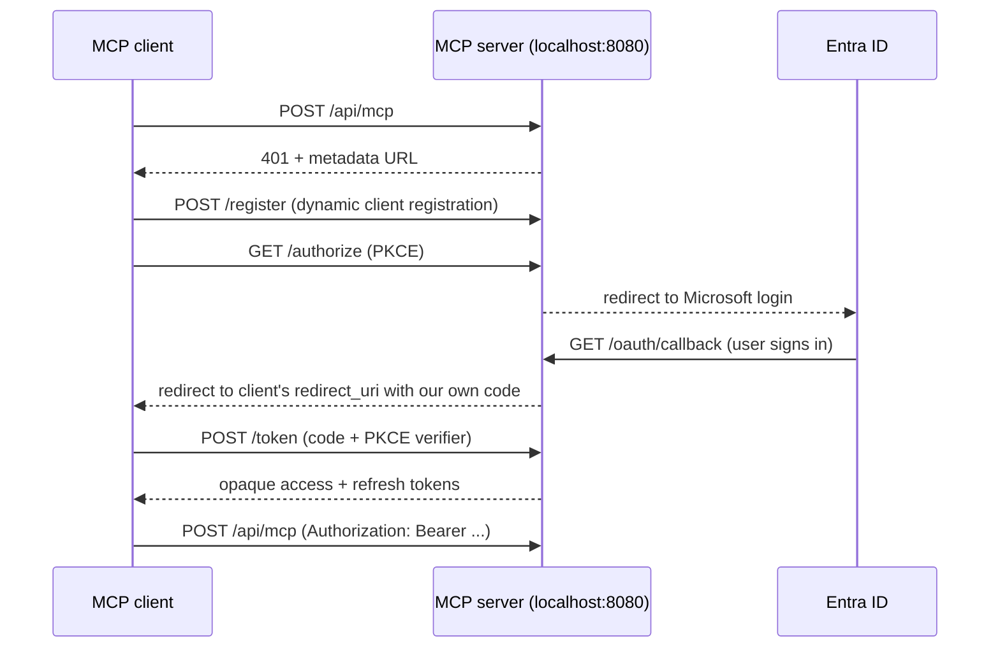

# MCP OAuth sign-in

The MCP server signs users in the same way hosted MCP servers do: the client opens the browser, the user signs in, and the browser returns to the client. No tool call or copy-pasted link is involved.

To get started, see the [setup guide](setup.md).

## How it works

Entra ID doesn't support dynamic client registration, which MCP clients expect. So the server acts as its own OAuth authorization server for MCP clients and proxies the actual sign-in to Entra:

The server never hands Entra's tokens to the client. Entra tokens stay in MSAL's cache, keyed by the user's account (`home_account_id`). The client gets opaque tokens issued by this server, which map to that account. Each tool call looks up the user from the bearer token and gets a Graph token for them.

## Limits

- State is in memory. Restarting the server drops all clients and tokens, so users must authenticate again.
- Access tokens last 1 hour; refresh tokens last 30 days and rotate on use.
- Intended for single-user local use: bound to `127.0.0.1`. Client registration is open but only loopback redirect URIs (`localhost`, `127.0.0.1`, `::1`) are accepted, so a code can't be sent to a remote host.
- If the user's Entra session is lost (its refresh token expired or was revoked), the server rejects the client's tokens with a 401 so the client restarts the sign-in. Temporary Microsoft errors (throttling, 5xx) only fail that tool call and keep the session.
- Logging out revokes the calling client's tokens. The Entra session is dropped only once no other client holds tokens for that user (the tool's reply says which happened).
- At most 100 clients can be registered; at the cap, clients that never got tokens and registered over 10 minutes ago are evicted. Pending Microsoft sign-ins are capped at 1000. Expired codes and tokens are purged on each new registration, authorization and token issue.
