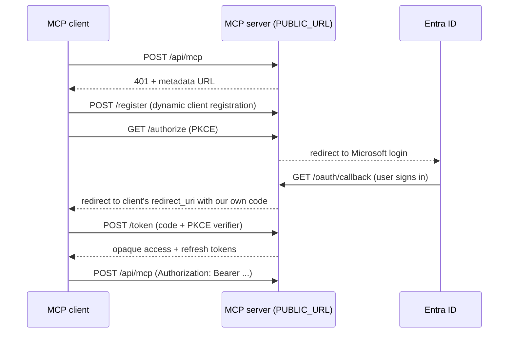

# MCP OAuth sign-in

The MCP server signs users in the same way hosted MCP servers do: the client opens the browser, the user signs in, and the browser returns to the client. No tool call or copy-pasted link is involved.

To get started, see the [setup guide](setup.md).

## How it works

Entra ID doesn't support dynamic client registration, which MCP clients expect. So the server acts as its own OAuth authorization server for MCP clients and proxies the actual sign-in to Entra:

The server never hands Entra's tokens to the client. Entra tokens stay in a per-user MSAL cache, keyed by the user's account (`home_account_id`), stored in Postgres (`msal_cache`) encrypted with `TOKEN_ENCRYPTION_KEY`. The client gets opaque tokens issued by this server, which map to that account; the database holds only their SHA-256 hashes (`oauth_tokens`). Each tool call looks up the user from the bearer token and gets a Graph token for them. Because all of this lives in Postgres, any replica can serve any request and a restart keeps everyone signed in.

## Limits

- Access tokens last 1 hour; refresh tokens last 30 days and rotate on use (a replayed refresh token is refused).
- Client registration is open, but only to loopback redirect URIs (`localhost`, `127.0.0.1`, `::1`, any port) and the exact URIs in `OAUTH_ALLOWED_REDIRECT_URIS`, so a code can't be sent to a host the operator didn't approve.
- The issuer, resource URL and Entra redirect URI derive from `PUBLIC_URL` (default `http://localhost:<PORT>`); behind a TLS proxy set it to the public https URL. See [Team use](setup.md#team-use-not-set-up).
- A database leak exposes only token hashes and encrypted Entra caches; together with `TOKEN_ENCRYPTION_KEY` it would expose every signed-in user's access, so keep the key elsewhere.
- If the user's Entra session is lost (its refresh token expired or was revoked), the server rejects the client's tokens with a 401 so the client restarts the sign-in. Temporary Microsoft errors (throttling, 5xx) only fail that tool call and keep the session.
- Logging out revokes the calling client's tokens. The Entra session is dropped only once no other client holds tokens for that user (the tool's reply says which happened).
- At most `OAUTH_MAX_CLIENTS` (default 1000) clients can be registered; at the cap, clients that never got tokens and registered over 10 minutes ago are evicted. Pending Microsoft sign-ins are capped at 1000 and expire after 10 minutes. Expired codes and tokens are purged on each registration and token issue.
- `/register` and `/authorize` need no sign-in, so someone who can reach the server can fill those caps and lock out new sign-ins (existing sessions keep working). For an internet-facing deployment, rate-limit both paths per client IP at the proxy.
